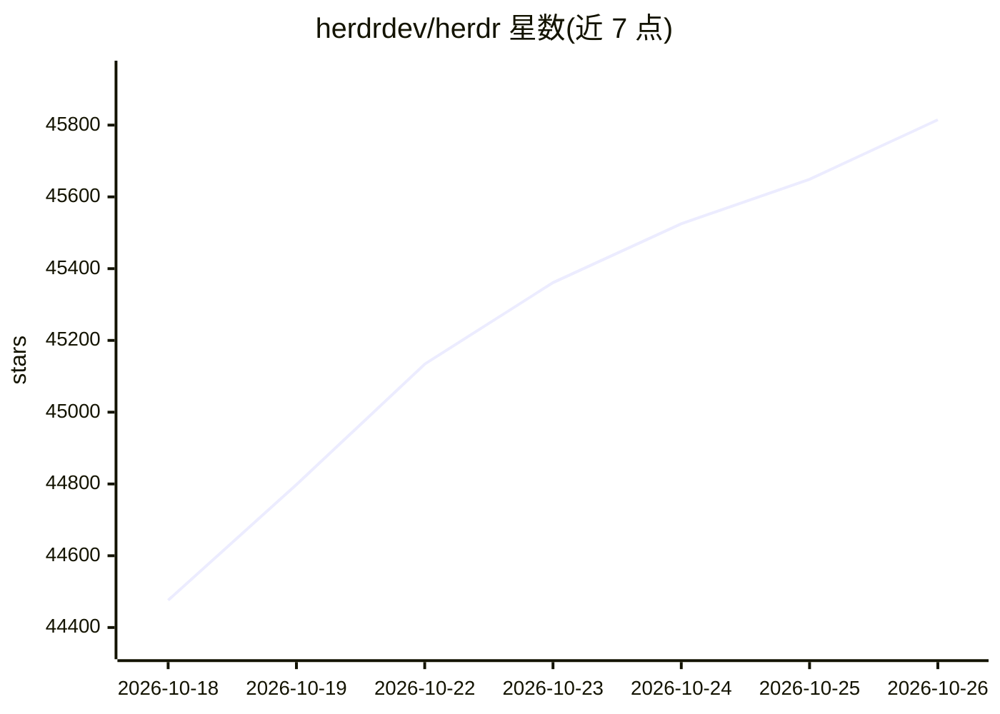

# herdrdev/herdr

⭐ 45,815 · Rust · Apache-2.0 · 推送 2026-10-23 · [GitHub](https://github.com/herdrdev/herdr) · [官网](https://herdr.dev) · 组织维护

**给编码 Agent 提供后台会话复用与多机终端管理的运行时**

用 Rust 编写的终端复用器，定位为编码 Agent 的运行时：客户端断开或 SSH 掉线后终端在后台服务器继续运行，重启后恢复布局并可恢复受支持的 Agent 会话；支持本地与 SSH 机器合并为统一 Agent 列表，每个窗格标记 working/blocked/idle 状态。Agent 可通过 CLI 与 socket API 驱动 herdr（互相生成窗格、发送提示、等待阻塞）。单个二进制运行，提供插件与市场。

## 筛选速览

| 维度 | 判定 | 备注 |
|---|---|---|
| AI 角色 | `ai-ecosystem` | LLM/agent 周边工具 |
| 许可风险 | `permissive` | Apache-2.0 |
| 部署形态 | `None` |  |
| 模型依赖 | — | README 未给出锁定关系 |
| 硬件要求 | — | 无带数字的原话,不猜 |
| 安装摩擦 | `medium` | 含编译或系统依赖之一 |
| 成熟度 | — | 结构信号不足 |

## 动量与使用信号

- 维护:`active` — 距上次 push 2.4 天,年发版 98,89 位贡献者
- 涨星:近 1 天 **+215**(自 20261016 起算)
- 平台:WINDOWS · 协议:—

## 能力要点

- 客户端关闭/SSH 掉线后台服务器保持运行，重启后恢复布局与部分 Agent 会话
- 窗格状态标记（working/blocked/idle），Agent 阻塞等待输入时提示
- agent-native：CLI 与 socket API 供 Agent 生成窗格、互相提示与等待
- 单一 Rust 二进制，tmux 风格快捷键与鼠标操作并存

## 适用场景

- SSH 远程跑编码 Agent，断线后回来继续会话
- 一个窗口管理本地与多台远程机器上的多个 Agent
- 让 Agent 之间通过 CLI/socket API 协作执行任务

## 场景标签

 · 领域:开发者工具/终端与 Agent 编排

## 证据(README 行号)

> L18: **the runtime your coding agents live on.**
> L23: - **agent-native** — agents drive herdr through the cli and socket api: they can spawn panes, prompt each other, an
> L24: - **runs what you already run** — claude code, codex, cursor, opencode, grok and the rest. herdr doesn't wrap or re

## 星数曲线

2026-10-18 44,476 → 2026-10-26 45,815（+1,339）

---
*卡片 v1 · prompt 1.4 · 生成 2026-10-18 · 置信度 high · 依据 README sha `337822678d40` · [字段定义](../../DATASET.md)*
