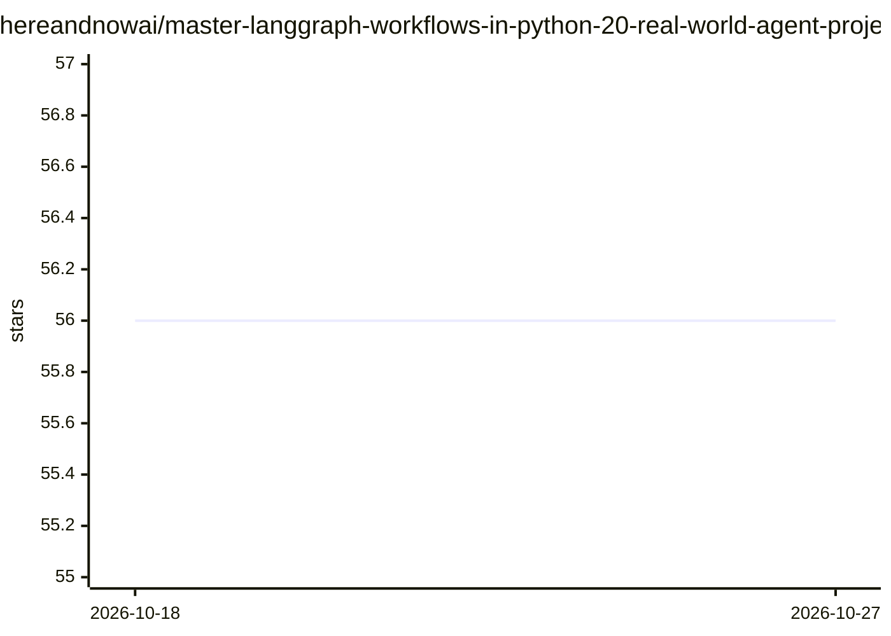

# hereandnowai/master-langgraph-workflows-in-python-20-real-world-agent-projects-by-hereandnow-ai

⭐ 56 · Python · MIT · 推送 2026-01-30 · [GitHub](https://github.com/hereandnowai/master-langgraph-workflows-in-python-20-real-world-agent-projects-by-hereandnow-ai) · [官网](https://hereandnowai.com) · 组织维护

**LangGraph 入门教程库：20 个 Python AI agent 实战项目**

由 HERE AND NOW AI 维护的 LangGraph v0.5.3 动手教程仓库，包含 20 个独立学习项目，覆盖基础聊天 agent、工具集成、记忆、human-in-the-loop、多 agent 编排，以及金融、HR、营销等场景。基于 Python≥3.9 与 LangChain 的 Cerebras 集成（gemini-2.5-flash），需设置 Cerebras/Tavily API key。每个项目含 main.py（≤20 行）与含 Business Value 的 README。适合希望学习 LangGraph 状态图与 agent 开发的初学者。

## 筛选速览

| 维度 | 判定 | 备注 |
|---|---|---|
| AI 角色 | `ai-knowledge` | 知识聚合/清单类 |
| 许可风险 | `permissive` | MIT |
| 部署形态 | `library` | 以包/库形式分发 |
| 模型依赖 | — | README 未给出锁定关系 |
| 硬件要求 | — | 无带数字的原话,不猜 |
| 安装摩擦 | `low` | 无编译、无系统依赖或容器化 |
| 成熟度 | — | 结构信号不足 |

## 能力要点

- 20 个由浅入深的独立 agent 学习项目
- 基于 LangGraph v0.5.3 与 LangChain Cerebras 集成
- 每个项目含 main.py、README 及 Business Value 说明
- 根目录统一 requirements.txt 与环境配置步骤

## 适用场景

- 跟着 20 个渐进式项目学习 LangGraph 状态图开发
- 参考金融助手、HR 问答等多 agent 工作流实现
- 了解 human-in-the-loop、节点缓存等 LangGraph 机制用法

## 场景标签

`教程课程` · 领域:学习与行业

## 证据(README 行号)

> L7: Welcome to the definitive **LangGraph tutorial** repository, meticulously crafted by **HERE AND NOW AI** – *designed
> L9: Each project is designed to be a standalone learning module, covering essential LangGraph concepts and demonstrating
> L68: Here's a brief overview of the 20 projects, designed to progressively build your skills in **AI agent development**

## 星数曲线

2026-10-18 56 → 2026-10-27 56（+0）

---
*卡片 v1 · prompt 1.4 · 生成 2026-10-24 · 置信度 high · 依据 README sha `515290e84db2` · [字段定义](../../DATASET.md)*
