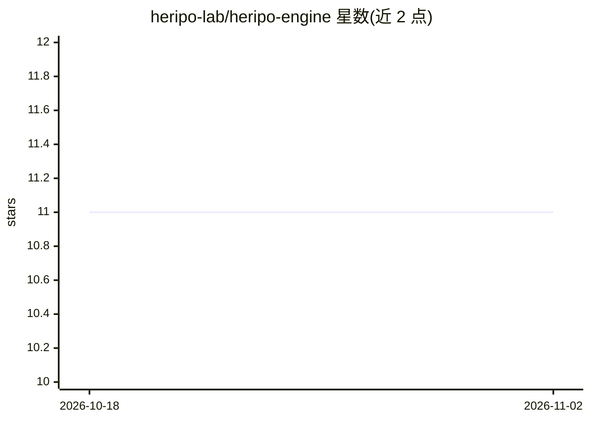

# heripo-lab/heripo-engine

⭐ 11 · TypeScript · Apache-2.0 · 推送 2026-11-01 · [GitHub](https://github.com/heripo-lab/heripo-engine) · [官网](https://engine-demo.heripo.org) · 组织维护

**从考古发掘报告 PDF 抽取结构化数据的 TypeScript 库**

pnpm monorepo 形式的库集合：pdf-parser 用 Docling SDK 在本地做 OCR（macOS 上用 Apple Vision 后端），document-processor 做目录/章节/页码/图表标题等结构抽取（规则+LLM），ledger-extractor 生成实验性 archaeology-ledger.v1 账本，保留原文出处并带调用/Token 上限的支出保护。面向考古与数字人文研究者及开发者，需 macOS 环境；账本格式在 0.2.x 内可能变动，自动目录抽取失败会中止处理。另有在线 demo 与私有 alpha 应用 heripo basecamp。

## 筛选速览

| 维度 | 判定 | 备注 |
|---|---|---|
| AI 角色 | `ai-ecosystem` | LLM/agent 周边工具 |
| 许可风险 | `permissive` | Apache-2.0 |
| 部署形态 | `library` | 以包/库形式分发 |
| 模型依赖 | — | README 未给出锁定关系 |
| 硬件要求 | — | 无带数字的原话,不猜 |
| 安装摩擦 | `low` | 无编译、无系统依赖或容器化 |
| 成熟度 | `idea` | |

## 能力要点

- Docling 本地 OCR + 强制 VLM 文本校正的 PDF 解析
- 目录/章节层级/页码映射/图表标题的结构化抽取，支持 OpenAI/Anthropic/Google 等多家 LLM
- 实验性 archaeology-ledger.v1 账本：候选发现、双方一致性确认、原文出处保留
- 对受损扫描 PDF 等其他领域文档也可用其 PDF 结构化能力

## 适用场景

- 把数百页考古发掘报告 PDF 转为结构化数据与账本
- 对扫描质量差的建筑/历史领域 PDF 做文本、表格、目录抽取
- 为考古研究平台构建结构化报告数据集

## 场景标签

`OCR` `文档解析` · 领域:知识与检索

## 证据(README 行号)

> L30: heripo engine is a collection of tools for analyzing archaeological excavation report PDFs and extracting structure
> L137: - **LLM Flexibility**: Support for various LLMs including OpenAI, Anthropic, Google

## 星数曲线

2026-10-18 11 → 2026-11-02 11（+0）

---
*卡片 v1 · prompt 1.4 · 生成 2026-11-02 · 置信度 high · 依据 README sha `c56acae3d809` · [字段定义](../../DATASET.md)*
