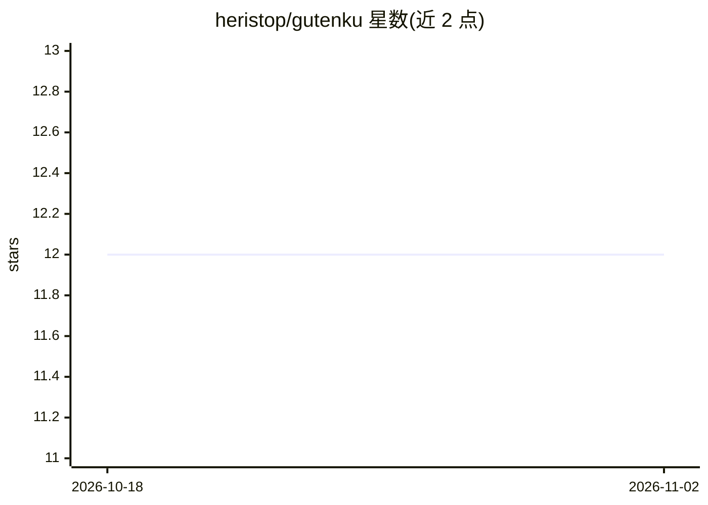

# heristop/gutenku

⭐ 12 · TypeScript · GPL-3.0 · 推送 2026-10-28 · [GitHub](https://github.com/heristop/gutenku) · [官网](https://gutenku.xyz) · 个人维护

**从古腾堡公版书生成俳句诗歌的 Web 应用**

面向诗歌爱好者的全栈 Web 应用：抓取 Project Gutenberg 电子书文本，用马尔可夫链组句、NLP 强制 5-7-5 音节结构，经遗传算法与神经网络筛选候选，再由 OpenAI 精选并生成解读叙事，最终渲染可分享的图片卡片。附带每日俳句卡、猜原书谜题游戏与情感分析过滤。技术栈为 TypeScript + GraphQL + MongoDB 后端与 Vue 3 前端，通过 git clone 源码与 make 命令安装运行。

## 筛选速览

| 维度 | 判定 | 备注 |
|---|---|---|
| AI 角色 | `ai-native` | 本体是模型或模型工具 |
| 许可风险 | `viral` | GPL-3.0 |
| 部署形态 | `None` |  |
| 模型依赖 | — | README 未给出锁定关系 |
| 硬件要求 | — | 无带数字的原话,不猜 |
| 安装摩擦 | `medium` | 含编译或系统依赖之一 |
| 成熟度 | — | 结构信号不足 |

## 能力要点

- 马尔可夫链+遗传算法+神经网络生成 5-7-5 俳句
- OpenAI 参与候选精选与叙事生成
- 每日俳句卡与猜原书谜题游戏
- 生成可分享社交图片卡片

## 适用场景

- 自动从经典文学中生成俳句并获取 AI 解读
- 每天玩猜俳句出处书籍的谜题
- 制作俳句图片卡片分享到社交平台

## 场景标签

`AI 写作` `图像生成` · 领域:内容生成

## 证据(README 行号)

> L27: GutenKu transforms classic literature from Project Gutenberg into haiku poetry using NLP, Markov Chain algorithms, 
> L42: 4. **Evolve** — Genetic algorithm optimizes haiku through natural selection; a neural network learns which patterns

## 星数曲线

2026-10-18 12 → 2026-11-02 12（+0）

---
*卡片 v1 · prompt 1.4 · 生成 2026-11-01 · 置信度 high · 依据 README sha `db068c400b96` · [字段定义](../../DATASET.md)*
