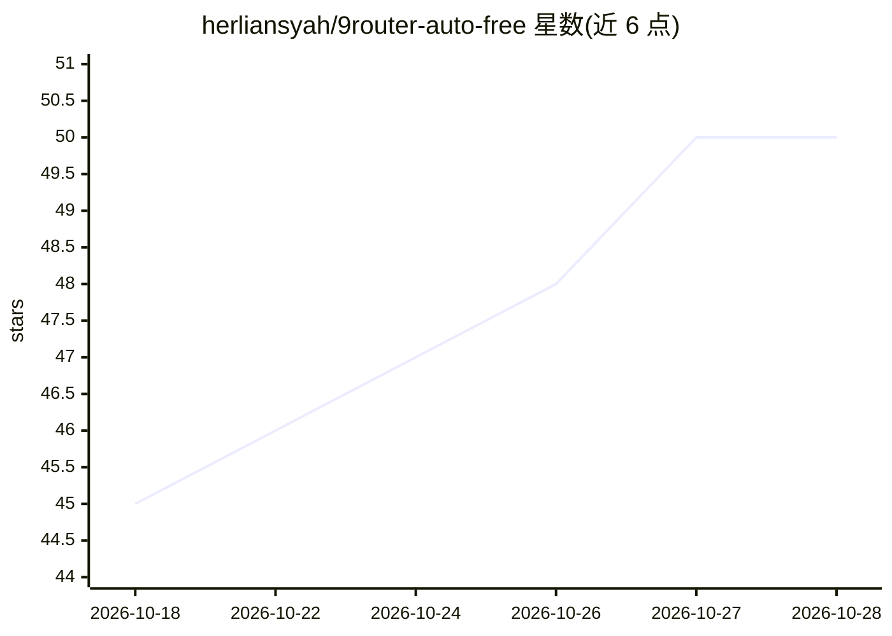

# herliansyah/9router-auto-free

⭐ 50 · JavaScript · MIT · 推送 2026-10-21 · [GitHub](https://github.com/herliansyah/9router-auto-free) · [官网](https://www.npmjs.com/package/9router-auto-free) · 个人维护

**为 9router 自动聚合免费 AI 编程模型的抓取与注入工具**

面向 9router 用户的 npm/CLI 工具：从 15+ 内置 provider 及 9router SQLite 中已有连接抓取 100+ 免费 AI 编程模型，通过 9router 内部端点做并行实测（HTTP 状态与延迟），按 EvalPlus/SWE-bench 等基准与延迟排名，然后把组合（my9model-free/smart/fast 等）写入 9router 数据库，供 Cursor、Claude Code、Aider 等 OpenAI 兼容客户端调用。含 Web 管理控制台（端口 20129）、每日同步与限流看护的定时任务安装。凭据始终保存在 9router 内，仓库不存储或传输 API key。

## 筛选速览

| 维度 | 判定 | 备注 |
|---|---|---|
| AI 角色 | `ai-ecosystem` | LLM/agent 周边工具 |
| 许可风险 | `permissive` | MIT |
| 部署形态 | `library` | 以包/库形式分发 |
| 模型依赖 | local-ok | 支持本地模型 |
| 硬件要求 | — | 无带数字的原话,不猜 |
| 安装摩擦 | `low` | 无编译、无系统依赖或容器化 |
| 成熟度 | — | 结构信号不足 |

## 能力要点

- 6 阶段流水线：抓取→过滤→实测→判定→排名→SQLite 注入
- 跨 provider 组合：my9model-free/smart/fast/cooldown 四个统一组合
- 内置 Web 管理控制台（端口 20129），双语界面与 SSE 日志流
- 定时任务安装：每日 00:05 同步与每小时限流看护（Systemd/crontab）

## 适用场景

- 让 Cursor、Claude Code、Aider 等 IDE 工具自动使用活跃的免费编程模型
- 免手动管理 API key 地轮换多个免费模型 provider
- 通过 Web 控制台查看免费模型排行榜并调整排除/优先列表

## 场景标签

`模型评测` `模型网关` · 领域:Agent 开发

## 证据(README 行号)

> L10: Automated intelligent system that aggregates **100+ free AI coding models** from top providers, validates them via 
> L61: 3. **Parallel Live Pre-Test**: Tests each model candidate through 9router's internal endpoints (`POST /api/models/t
> L102: - **OpenAI Base URL**: `http://localhost:20128/v1`

## 星数曲线

2026-10-18 45 → 2026-10-28 50（+5）

---
*卡片 v1 · prompt 1.4 · 生成 2026-10-25 · 置信度 high · 依据 README sha `4cb961f044cf` · [字段定义](../../DATASET.md)*
