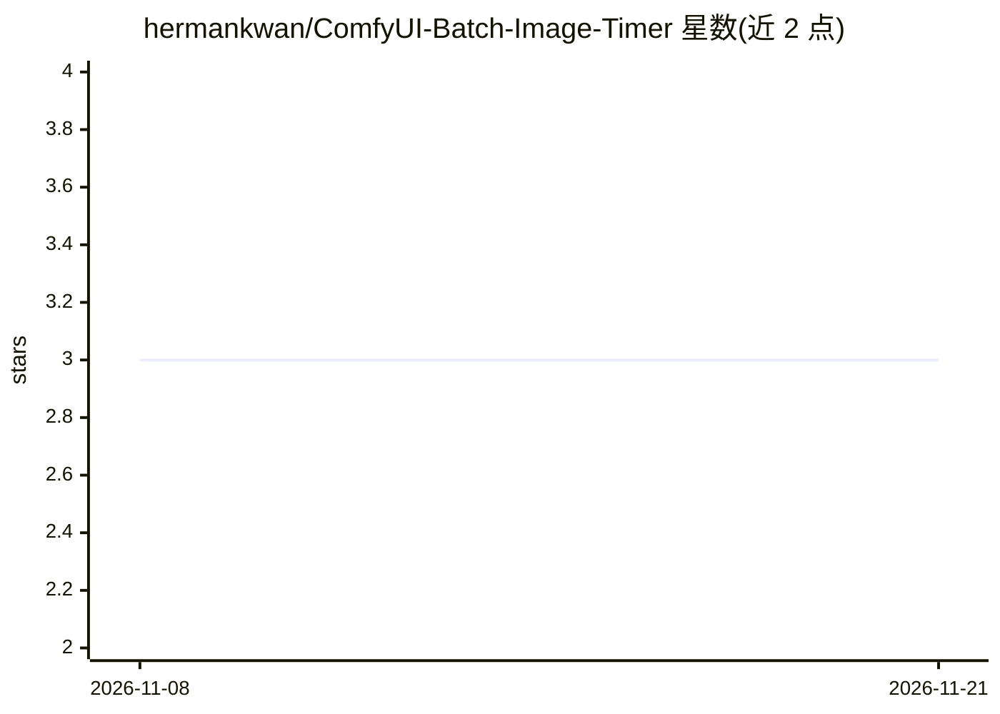

# hermankwan/ComfyUI-Batch-Image-Timer

⭐ 3 · JavaScript · MIT · 推送 2026-10-31 · [GitHub](https://github.com/hermankwan/ComfyUI-Batch-Image-Timer) · [官网](https://registry.comfy.org/publishers/hermankwan/nodes/comfyui-batch-image-timer) · 个人维护

**ComfyUI 批量图像工作流的七段数码管实时计时节点**

面向 ComfyUI 批量图像处理工作流的计时自定义节点：在画布上以七段 LED 显示实时计时，支持 COMPUTE（纯执行时间，可暂停/恢复）、TOTAL（墙钟时间）与 ETA（按已完成迭代以 30/70 加权估算剩余时间）三种模式，并带颜色编码的 [X/Y] 进度计数器。依赖 ComfyUI 事件而非外部 Python 依赖，通过 ComfyUI-Manager 或 git clone 安装；颜色选择随工作流 JSON 持久化。

## 筛选速览

| 维度 | 判定 | 备注 |
|---|---|---|
| AI 角色 | `ai-enhanced` | 去掉 AI 部分产品仍成立 |
| 许可风险 | `permissive` | MIT |
| 部署形态 | `None` |  |
| 模型依赖 | — | README 未给出锁定关系 |
| 硬件要求 | — | 无带数字的原话,不猜 |
| 安装摩擦 | `low` | 无编译、无系统依赖或容器化 |
| 成熟度 | — | 结构信号不足 |

## 能力要点

- COMPUTE/TOTAL/ETA 三种计时模式，ETA 支持暂停与平滑估算
- 七段 LED 显示与五色可切换配色，随工作流 JSON 保存
- 多工作流显示隔离，每次执行仅一个计时节点显示实时数据
- 10 分钟无信号死锁兜底，后端确认空闲后自动停止

## 适用场景

- 为顺序加载器的批量图像生成流程统计整批耗时
- 在 ComfyUI 中预估剩余批处理时间并观察进度
- 排查第三方节点死锁导致的队列卡住

## 场景标签

`图像生成` · 领域:内容生成

## 证据(README 行号)

> L11: A specialized custom node for ComfyUI focused on **batch image processing workflows**, providing a **real-time 7-se
> L42: > **Note:** This node relies strictly on native web standard components and ComfyUI API events. No external Python 

## 星数曲线

2026-11-08 3 → 2026-11-21 3（+0）

---
*卡片 v1 · prompt 1.4 · 生成 2026-11-21 · 置信度 high · 依据 README sha `9391662e9b92` · [字段定义](../../DATASET.md)*
