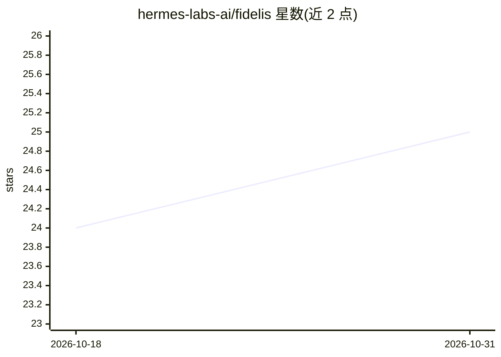

# hermes-labs-ai/fidelis

⭐ 25 · Python · Apache-2.0 · 推送 2026-10-19 · [GitHub](https://github.com/hermes-labs-ai/fidelis) · [官网](https://hermes-labs.ai) · 组织维护

**本地优先的 agent 记忆存储与检索库，默认逐字返回原文**

面向 Codex、Claude Code 等 agent 的本地记忆层：保存 Markdown 与文本笔记，跨会话检索。默认检索不做生成式改写，逐字返回原始段落；zero_llm 档位的混合检索结合 BM25 关键词与向量结果，无需生成式 LLM，但本地嵌入依赖 Ollama（nomic-embed-text）。支持修正记录可覆盖但保留历史。通过 MCP 连接接入 agent 客户端，安装为 per-user 后台服务（launchd/systemd --user），数据存于 ~/.cogito/store。当前为 0.3.0rc1 单机预发布版，非托管团队记忆服务。

## 筛选速览

| 维度 | 判定 | 备注 |
|---|---|---|
| AI 角色 | `ai-ecosystem` | LLM/agent 周边工具 |
| 许可风险 | `permissive` | Apache-2.0 |
| 部署形态 | `library` | 以包/库形式分发 |
| 模型依赖 | local-ok | 支持本地模型 |
| 硬件要求 | — | 无带数字的原话,不猜 |
| 安装摩擦 | `low` | 无编译、无系统依赖或容器化 |
| 成熟度 | `idea` | |

## 能力要点

- 默认逐字存储与返回原始段落，不经生成式模型改写
- zero_llm 档位混合检索：关键词+向量融合，无需生成式 LLM
- 通过 MCP 接入 Codex、Claude Code、Cursor、Gemini CLI、Copilot CLI 等客户端
- 修正可覆盖旧记录但保留历史与有效性状态

## 适用场景

- 让编程 agent 跨会话记住带条件的原始笔记（如重试前置条件）
- 本地存储项目笔记并按原话检索，避免摘要丢失关键细节
- 为多个 agent 客户端共享同一份本地记忆库

## 场景标签

`Agent 记忆` · 领域:Agent 开发

## 证据(README 行号)

> L7: Local memory for Codex, Claude Code, and other agents: save text across sessions and retrieve the original passage w
> L36: Once the note is retrievable locally, install the MCP connection for your client:
> L51: - **Local retrieval.** Fast vector search is the default MCP recall path. Explicit hybrid search combines keyword a

## 星数曲线

2026-10-18 24 → 2026-10-31 25（+1）

---
*卡片 v1 · prompt 1.4 · 生成 2026-10-27 · 置信度 high · 依据 README sha `a2a4a2149ea9` · [字段定义](../../DATASET.md)*
