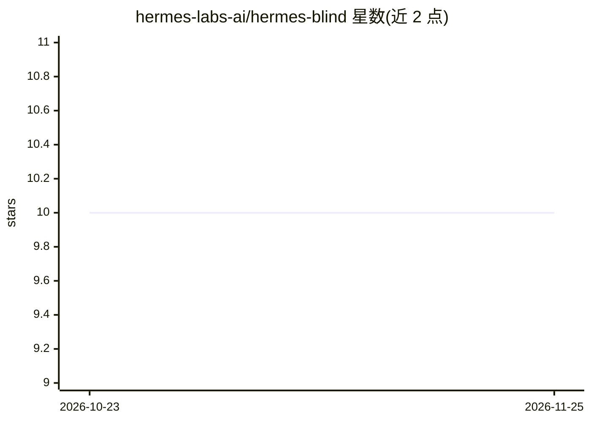

# hermes-labs-ai/hermes-blind

⭐ 10 · Python · Apache-2.0 · 推送 2026-10-02 · [GitHub](https://github.com/hermes-labs-ai/hermes-blind) · [官网](https://hermes-labs.ai/open-source) · 组织维护

**从长编码 agent 会话首轮恢复原始目标的 CLI 工具**

读取本地 Claude Code 或 Codex 会话的 JSONL 日志，解析第一条真实用户发言（跳过工具输出、子代理轮次、压缩摘要、注入上下文等），生成可检查的 Markdown 恢复锚点，供粘贴或通过 hook 注入回会话。提供 goals/first-sentence/full 三种提取模式，支持 Hermes Agent 的 pre_llm_call 注入钩子，并附带给评测提示词加证据与不确定性约束的包装器。纯本地、确定性、无模型调用与网络请求，运行时无依赖。状态为 experimental，Python 3.10+。

## 筛选速览

| 维度 | 判定 | 备注 |
|---|---|---|
| AI 角色 | `ai-ecosystem` | LLM/agent 周边工具 |
| 许可风险 | `permissive` | Apache-2.0 |
| 部署形态 | `library` | 以包/库形式分发 |
| 模型依赖 | — | README 未给出锁定关系 |
| 硬件要求 | — | 无带数字的原话,不猜 |
| 安装摩擦 | `low` | 无编译、无系统依赖或容器化 |
| 成熟度 | `idea` | |

## 能力要点

- 确定性提取首条用户发言，不做模型摘要
- 三种提取模式适配不同上下文预算
- 可作为 Claude Code / Codex CLI / Gemini CLI 的插件或技能安装
- 支持 pre_llm_call hook 在指定轮次注入锚点

## 适用场景

- 长会话上下文变噪后重新声明最初目标
- 作为 agent 可调用的技能自动恢复用户意图
- 为 LLM 评测提示词统一加证据与对冲约束

## 场景标签

`提示工程` `模型评测` · 领域:Agent 开发

## 证据(README 行号)

> L5:  Recover the original goal of a long coding-agent session before the context around it gets noisy.
> L27: It reads the first user turn from a supported local session transcript and generates a compact, inspectable recover
> L31: Hermes Blind also includes an evidence-bound prompt wrapper for LLM evaluation workflows. That is a secondary surfa

## 星数曲线

2026-10-23 10 → 2026-11-25 10（+0）

---
*卡片 v1 · prompt 1.4 · 生成 2026-11-19 · 置信度 high · 依据 README sha `01aeb32f6274` · [字段定义](../../DATASET.md)*
