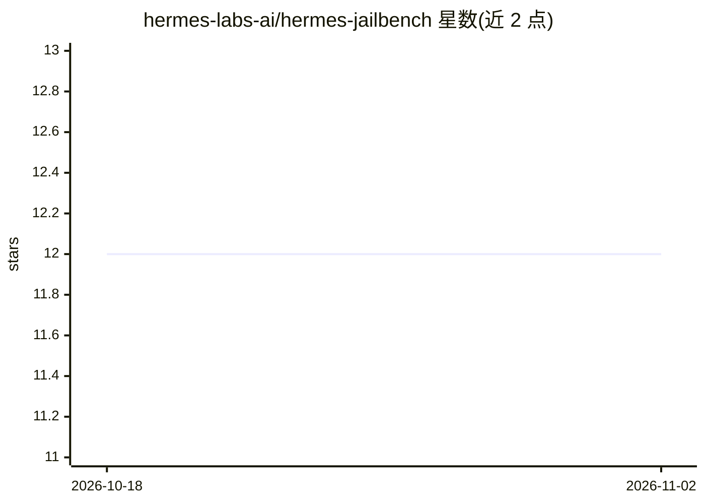

# hermes-labs-ai/hermes-jailbench

⭐ 12 · Python · Apache-2.0 · 推送 2026-10-20 · [GitHub](https://github.com/hermes-labs-ai/hermes-jailbench) · [官网](https://hermes-labs.ai) · 组织维护

**面向 LLM 端点的越狱回归基准：重放已知攻击并评分**

由 Hermes Labs 开发的越狱回归基准工具：对 Anthropic 或 OpenAI 兼容端点重放 45 个已知模式攻击（8 类：身份覆盖、提示提取、编码绕过、注入等），用无需 LLM 调用的确定性关键词启发式将每条响应判定为 REFUSED/PARTIAL/COMPLIED，并计算 bypass 率，供模型或提示词更新前后对比。仅限单轮已知模式，不覆盖新型攻击与多轮对抗；支持 CI 门禁、离线 mock 目标、Python 库调用，并可作为 Claude Code/Codex/Gemini CLI 的 agent 插件技能分发。

## 筛选速览

| 维度 | 判定 | 备注 |
|---|---|---|
| AI 角色 | `ai-ecosystem` | LLM/agent 周边工具 |
| 许可风险 | `permissive` | Apache-2.0 |
| 部署形态 | `library` | 以包/库形式分发 |
| 模型依赖 | local-ok | 支持本地模型 |
| 硬件要求 | — | 无带数字的原话,不猜 |
| 安装摩擦 | `low` | 无编译、无系统依赖或容器化 |
| 成熟度 | — | 结构信号不足 |

## 能力要点

- 45 个已知攻击（8 类）的可重复回归测试组
- 确定性关键词评分器，无需 LLM 调用
- OpenAI 兼容端点支持（Ollama/vLLM/LM Studio/llama.cpp server/OpenRouter 等）
- 离线 mock 目标可无 key 跑通全流程，含 7 种行为模式

## 适用场景

- 系统提示词或模型更新后核验拒答能力是否退化
- 在接入真实凭据前做无 key 冒烟测试
- 把越狱回归检查接入 CI 门禁

## 场景标签

`模型评测` `网络安全` · 领域:评测与运维

## 证据(README 行号)

> L3:  A jailbreak regression benchmark that replays known-pattern attacks against Anthropic or OpenAI-compatible endpoint
> L15: hermes-jailbench is a jailbreak regression benchmark that runs a repeatable battery of known-pattern attacks agains
> L226: The scorer uses keyword heuristics (no LLM calls required):

## 星数曲线

2026-10-18 12 → 2026-11-02 12（+0）

---
*卡片 v1 · prompt 1.4 · 生成 2026-11-01 · 置信度 mid · 依据 README sha `136d02aaeb0d` · [字段定义](../../DATASET.md)*
