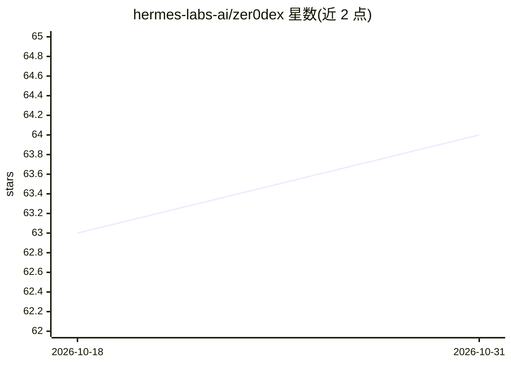

# hermes-labs-ai/zer0dex

⭐ 64 · Python · Apache-2.0 · 推送 2026-10-19 · [GitHub](https://github.com/hermes-labs-ai/zer0dex) · [官网](https://hermes-labs.ai) · 组织维护

**AI agent 双层长期记忆参考实现：可读索引+本地向量检索**

为长期运行 agent 提供双层记忆模式：一层是人工可读可编辑的 Markdown 索引（项目/类别/指针地图，保留在 agent 上下文中），另一层是本地向量存储（mem0+Chroma），agent 宿主在每次模型请求前调用 POST /query 按语义检索细节。默认路径用本地 Ollama 模型做嵌入与记忆抽取，配置与存储留在本机目录。提供 CLI 与回环 HTTP 服务，附 TypeScript 宿主适配器示例，但不自动挂接 agent。定位为该模式的参考实现，处于 0.1.x 开发者预览阶段，非托管团队服务或完整 agent 框架。

## 筛选速览

| 维度 | 判定 | 备注 |
|---|---|---|
| AI 角色 | `ai-ecosystem` | LLM/agent 周边工具 |
| 许可风险 | `permissive` | Apache-2.0 |
| 部署形态 | `library` | 以包/库形式分发 |
| 模型依赖 | local-ok | 支持本地模型 |
| 硬件要求 | — | 无带数字的原话,不猜 |
| 安装摩擦 | `low` | 无编译、无系统依赖或容器化 |
| 成熟度 | `idea` | |

## 能力要点

- Markdown 索引+本地向量存储的双层记忆结构
- 默认本地 Ollama 嵌入与记忆抽取，数据留在本机
- CLI 播种/追加/查询 + 回环 HTTP 服务（POST /query）
- 内置 86 条记忆、97 个用例评测（平均召回 91.2%）

## 适用场景

- 笔记已超出单个 MEMORY.md 的本地长期 agent 需要跨项目回忆
- 想保留一张可读记忆地图同时做语义检索
- 在自有 agent 宿主中实现请求前记忆查询的集成点

## 场景标签

`Agent 记忆` · 领域:Agent 开发

## 证据(README 行号)

> L35: The CLI can seed memories from Markdown, add more text, and query a loopback HTTP server. Your agent host calls `PO
> L37: The default path uses local Ollama models for embeddings and memory extraction, with mem0 and Chroma for storage. Y

## 星数曲线

2026-10-18 63 → 2026-10-31 64（+1）

---
*卡片 v1 · prompt 1.4 · 生成 2026-10-24 · 置信度 high · 依据 README sha `8e9e1a62b129` · [字段定义](../../DATASET.md)*
