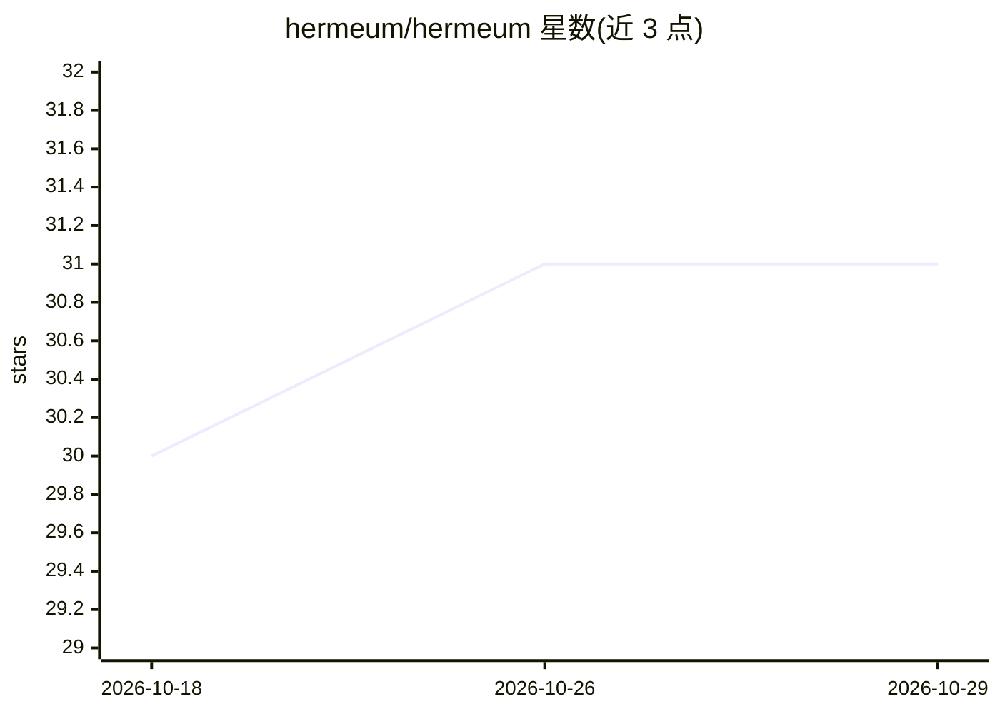

# hermeum/hermeum

⭐ 31 · TypeScript · AGPL-3.0 · 推送 2026-10-28 · [GitHub](https://github.com/hermeum/hermeum) · [官网](https://docs.hermeum.app) · 组织维护

**Kubernetes 上部署与管理 Hermes 自主 agent 的平台**

围绕 Hermes agent 构建的控制平面：通过自然语言对话生成 agent 配置，以 HermesAgent 自定义资源形式部署到 Kubernetes，由 operator 调和为独立 pod 运行。提供模板复用、跨 agent 共享凭据、会话监控（实时转录与模型调用/工具调用/错误遥测流）。以 Helm chart 形式安装，生产环境需配置 betterAuthSecret、SMTP 与 OpenAI API key；另提供基于 kind 的本地演示，chat 建 agent 流程需 OpenAI 兼容 key，也可从模板或手写配置创建。AGPL-3.0-or-later 许可。

## 筛选速览

| 维度 | 判定 | 备注 |
|---|---|---|
| AI 角色 | `ai-ecosystem` | LLM/agent 周边工具 |
| 许可风险 | `viral` | AGPL-3.0 |
| 部署形态 | `library` | 以包/库形式分发 |
| 模型依赖 | — | README 未给出锁定关系 |
| 硬件要求 | — | 无带数字的原话,不猜 |
| 安装摩擦 | `low` | 无编译、无系统依赖或容器化 |
| 成熟度 | — | 结构信号不足 |

## 能力要点

- 自然语言描述生成 agent 配置，替代手写 config.yaml
- agent 以 HermesAgent CR 部署，mutating admission webhook 在创建时塑形
- 会话监控：实时转录旁展示模型调用/工具调用/错误遥测
- 模板与共享 env sets 让团队跨 agent 标准化形状与凭据

## 适用场景

- 团队在 Kubernetes 上统一部署和运维多个 Hermes agent
- 通过对话快速生成可用 agent 而非手写配置
- 集中查看每个 agent 会话的转录与遥测事件
- 用模板复用团队常用的 agent 形态与凭据

## 场景标签

`Agent 框架` `LLM 可观测性` · 领域:Agent 开发

## 证据(README 行号)

> L23: - **Powered by Kubernetes** — agents run as `HermesAgent` custom resources, with
> L34: - **Manage many agents, not one** — each agent is a `HermesAgent` resource,

## 星数曲线

2026-10-18 30 → 2026-10-29 31（+1）

---
*卡片 v1 · prompt 1.4 · 生成 2026-10-26 · 置信度 high · 依据 README sha `f004dae51dd7` · [字段定义](../../DATASET.md)*
