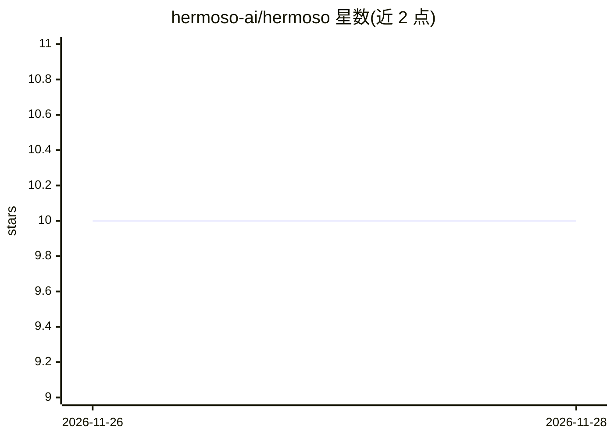

# hermoso-ai/hermoso

⭐ 10 · JavaScript · MIT · 推送 2026-11-27 · [GitHub](https://github.com/hermoso-ai/hermoso) · [官网](https://hermoso.ai/mcp/) · 组织维护

**AI 营销 agent 的 MCP server 与 CLI：从调研到投放广告**

Hermoso 将自身暴露为 MCP server、CLI 与 Claude 技能包，供 Claude Code、ChatGPT、Cursor 等外部 AI agent 调用其营销能力：检索 Meta/Google/LinkedIn 广告库做竞品调研，通过 render_ad、generate_image、generate_video 生成实拍产品合成的图片与视频广告，发布到 18 个社交渠道，并在 13 个广告平台上建立与管理付费投放（新广告默认暂停创建）。计费按积分计，模型调用无加价，发布与管理功能免费。托管托管用户 agent 写的站点文件但不改写。

## 筛选速览

| 维度 | 判定 | 备注 |
|---|---|---|
| AI 角色 | `ai-native` | 本体是模型或模型工具 |
| 许可风险 | `permissive` | MIT |
| 部署形态 | `library` | 以包/库形式分发 |
| 模型依赖 | — | README 未给出锁定关系 |
| 硬件要求 | — | 无带数字的原话,不猜 |
| 安装摩擦 | `low` | 无编译、无系统依赖或容器化 |
| 成熟度 | — | 结构信号不足 |

## 能力要点

- 以 MCP server、CLI（npx hermoso）与 11 个 Claude skills 三种形式接入任意 agent
- 覆盖 13 个广告平台（Meta/Google/TikTok/LinkedIn 等）的投放管理与 18 个渠道的发布调度
- AI 广告生成 API：图片、视频、UGC 头像广告，含产品合成、文案与 CTA
- 声明 1818 个工具，hermoso_capabilities 返回实时模型目录与积分成本

## 适用场景

- 让 AI agent 调研竞品投放中的广告素材与角度
- 从产品描述生成适配各版位的图片与视频广告
- 在 Meta、Google Ads 等平台建立并管理投放活动
- 将内容定时发布到 TikTok、Instagram 等多个社交渠道

## 场景标签

`AI 写作` `图像生成` · 领域:内容生成

## 证据(README 行号)

> L1: # Hermoso: AI marketing agent and AI ad generator for Claude, ChatGPT and Cursor (MCP server, CLI and skills)
> L3: **The AI marketing agent with an AI ad generator built in**, run from **any AI agent**: Claude Code, Claude.ai, Curs
> L37: - **AI ad generator API.** Image, video and UGC avatar ads with your real product, copy and CTA, from `render_ad`,

## 星数曲线

2026-11-26 10 → 2026-11-28 10（+0）

---
*卡片 v1 · prompt 1.4 · 生成 2026-11-26 · 置信度 high · 依据 README sha `fbbd76339597` · [字段定义](../../DATASET.md)*
