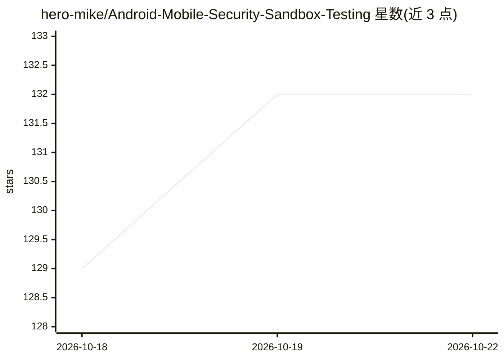

# hero-mike/Android-Mobile-Security-Sandbox-Testing

⭐ 132 · HTML · 推送 2026-10-21 · [GitHub](https://github.com/hero-mike/Android-Mobile-Security-Sandbox-Testing) · 个人维护

**Android 安全测试沙箱环境：集成 Magisk、Burp、Objection 与模拟器**

面向渗透测试人员、逆向工程师与安全研究者的 Android 应用评估沙箱框架，将 Magisk 模块管理（systemless root、BusyBox、init.d 脚本）、Burp Suite 代理配置（CA 证书安装、证书锁定绕过、VPN 拦截模式）、Objection 运行时工具（方法 hook、SQLite/SharedPreferences 探查、Frida gadget 注入）及调优过的 AVD 模拟器配置整合为单一编排脚本部署。兼容 Android 9-14，支持 Linux/macOS/Windows(WSL2)。README 仅含 'Download' 字样，未见具体安装命令与 AI 功能描述，主题标签中的 ai/ai-tools 在正文无对应内容。仅限授权测试用途，MIT 许可。

## 筛选速览

| 维度 | 判定 | 备注 |
|---|---|---|
| AI 角色 | `ai-enhanced` | 去掉 AI 部分产品仍成立 |
| 许可风险 | `none` | — |
| 部署形态 | `None` |  |
| 模型依赖 | — | README 未给出锁定关系 |
| 硬件要求 | — | 无带数字的原话,不猜 |
| 安装摩擦 | `low` | 无编译、无系统依赖或容器化 |
| 成熟度 | — | 结构信号不足 |

## 能力要点

- 单一编排脚本统一部署 Magisk、Burp、Objection 与模拟器配置
- Burp 代理集成：CA 证书自动安装、证书锁定绕过、代理/VPN 双拦截模式
- Objection 预置脚本：运行时方法 hook、数据库探查、Frida gadget 注入
- 调优 AVD 配置：反模拟器检测对抗、root 隐藏、x86/ARM 翻译层支持

## 适用场景

- 对目标 Android 应用做 API 拦截、加密存储检查与 root 检测绕过
- 在隔离沙箱中分析可疑 APK 的网络流量与进程行为
- 逆向闭源应用：hook 加密函数、导出并反编译 DEX 字节码

## 场景标签

`网络安全` · 领域:学习与行业

## 证据(README 行号)

> L7: Welcome to **JAMBOREE** — a meticulously orchestrated environment that bridges the gap between Android security rese
> L21: ### 1. Magisk Module Automation
> L28: ### 2. Burp Suite Integration
> L35: ### 3. Objection Runtime Toolkit

## 星数曲线

2026-10-18 129 → 2026-10-22 132（+3）

---
*卡片 v1 · prompt 1.4 · 生成 2026-10-22 · 置信度 low · 依据 README sha `336fe5146b02` · [字段定义](../../DATASET.md)*
