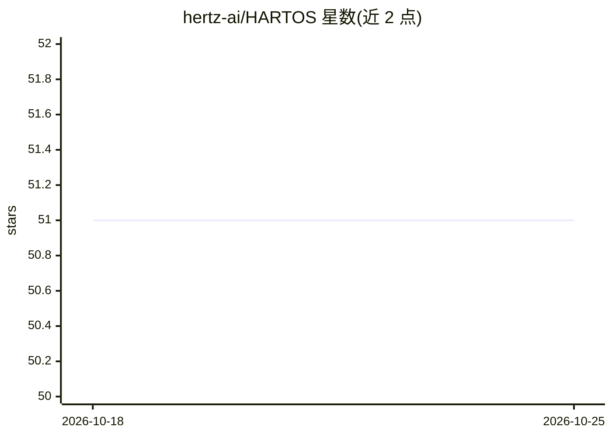

# hertz-ai/HARTOS

⭐ 51 · Python · Apache-2.0 · 推送 2026-10-23 · [GitHub](https://github.com/hertz-ai/HARTOS) · [官网](https://docs.hevolve.ai/) · 组织维护

**面向开发者与终端用户的本地优先 AI 原生运行时/OS**

单一代码库、三种打包形态：flat 模式作为普通应用随 Nunba 桌面安装包分发，regional/central 模式以 Docker 部署为联邦节点，HART OS 形态用 Nix 构建并直接引导（含 Smithay Wayland 合成器）。核心机制：本地推理作为系统服务（Model Bus，:6777，OpenAI 兼容 API），硬件分级（gpu_tier/vram_manager）决定模型放置于 GPU/CPU，8GB 内存可运行（精简版），无 CUDA 时 CPU 跑 0.8B-2B 模型；节点经 PeerLink 无中介点对点联邦，可将整轮对话交给更大模型的节点；支持 pyautogui 驱动桌面与任务 recipe 录制回放。限制：nixosTest 套件定义但未通过、学习代码未开源。

## 筛选速览

| 维度 | 判定 | 备注 |
|---|---|---|
| AI 角色 | `ai-ecosystem` | LLM/agent 周边工具 |
| 许可风险 | `permissive` | Apache-2.0 |
| 部署形态 | `self-host` | docker 或自建部署 |
| 模型依赖 | local-ok | 支持本地模型 |
| 硬件要求 | — | 无带数字的原话,不猜 |
| 安装摩擦 | `low` | 无编译、无系统依赖或容器化 |
| 成熟度 | `idea` | |

## 能力要点

- 本地推理作为系统服务，经 :6777 提供 OpenAI 兼容 API，任何 OpenAI SDK 可直接指向
- PeerLink 无中介点对点联邦，节点可将整轮交给模型更大的对等节点
- 硬件分级与 VRAM 预算管理：GPU/CPU-offload/CPU-only 自动放置，10GB+ CUDA 卡启用投机解码
- 视觉模型截屏 + pyautogui 操作真实桌面；任务 recipe 学习与回放

## 适用场景

- 在自有硬件上运行本地模型并通过 OpenAI 兼容 API 供多应用共用推理
- 局域网内多设备组网，将超出本机能力的请求交给更大模型节点
- 以 Docker 部署 regional/central 联邦节点
- 让 AI 操作本机桌面（浏览器等 GUI）

## 场景标签

`推理引擎` `Agent 框架` `多智能体` `GUI 自动化` · 领域:Agent 开发

## 证据(README 行号)

> L26: Android. This repo is the runtime underneath it: it serves local inference as a
> L104: Here inference is a service the system provides, the way it provides a
> L114: It is one Python codebase that federates over PeerLink, a direct peer-to-peer

## 星数曲线

2026-10-18 51 → 2026-10-25 51（+0）

---
*卡片 v1 · prompt 1.4 · 生成 2026-10-24 · 置信度 high · 依据 README sha `1d8e96b6a384` · [字段定义](../../DATASET.md)*
