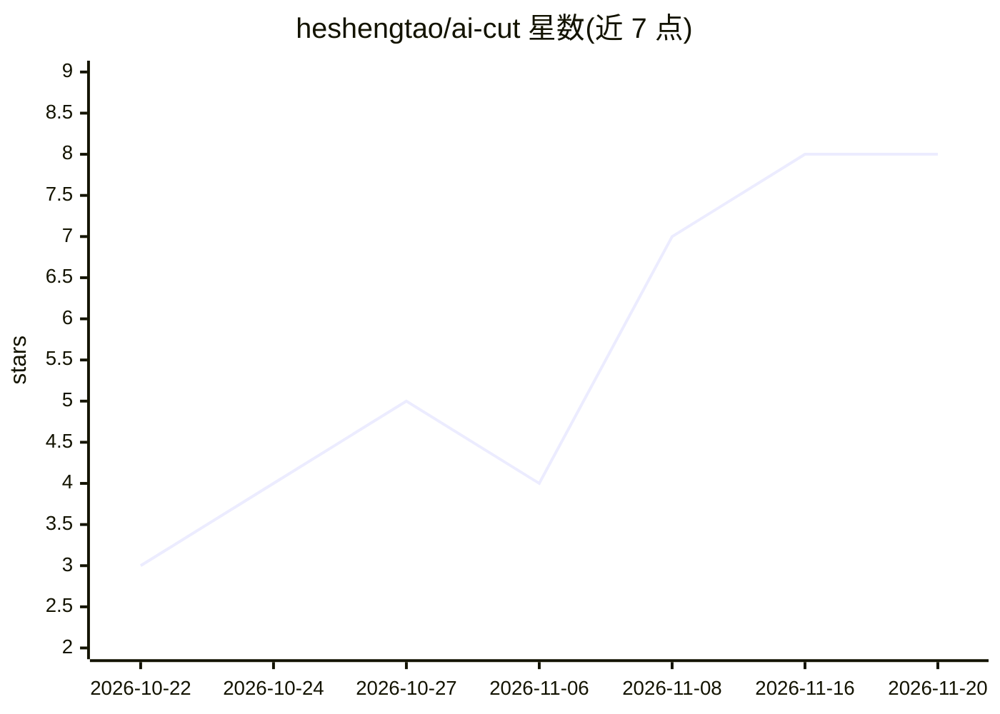

# heshengtao/ai-cut

⭐ 8 · Rust · Apache-2.0 · 推送 2026-11-18 · [GitHub](https://github.com/heshengtao/ai-cut) · 个人维护 · 中文 README

**桌面视频编辑工作站：让 AI agent 经 MCP 在时间线上剪辑**

基于 Tauri 的本地优先视频编辑器，包含多轨时间线、媒体库、检查器、文本/字幕/配音、OFX 特效插件管理，可导出 MP4、ProRes、GIF。其 AI 侧机制：内置 Skill 教任何支持 Agent Skills 的 AI harness 经内置 MCP 服务器（仅绑定 127.0.0.1）操作运行中的应用，agent 的每次编辑进入与 UI 相同的命令管线与撤销历史；另带 OpenAI 兼容端点的 clip agent 与 aicut CLI。本地字幕识别、TTS 与音视频 AI 工具在本机运行，编辑器本身无需账号、上传或 API key。

## 筛选速览

| 维度 | 判定 | 备注 |
|---|---|---|
| AI 角色 | `ai-native` | 本体是模型或模型工具 |
| 许可风险 | `permissive` | Apache-2.0 |
| 部署形态 | `desktop` | 安装包/桌面程序 |
| 模型依赖 | — | README 未给出锁定关系 |
| 硬件要求 | — | 无带数字的原话,不猜 |
| 安装摩擦 | `low` | 无编译、无系统依赖或容器化 |
| 成熟度 | `idea` | |

## 能力要点

- 内置 MCP 服务器（loopback HTTP，JSON/SSE）与 aicut CLI 客户端
- skills/aicut Skill 教 agent 读写项目、加轨、摆剪素材与撤销重做
- 本地字幕识别、TTS、智能剪切、音频/视频 AI 工具（本机运行）
- 托管 OFX 1.5.1 插件，支持六种 image-effect 上下文与 SHA-256 校验的插件管理器

## 适用场景

- 让 AI agent 代为导入素材、排布剪辑、改写字幕并在 UI 中实时查看
- 本地给视频生成可修正的字幕轨与对齐时序的配音
- 测试模型对剪辑的真实能力并收集带撤销历史的编辑轨迹
- 用 OFX 插件完成调色、模糊、转场等后期处理并导出 MP4/ProRes/GIF

## 场景标签

`语音合成` `图像视频处理` · 领域:内容生成

## 证据(README 行号)

> L16: **AI Cut is a small, AI-native video editor for your desktop** — cut, caption, voice, mix, and export in one lightw
> L115: - **Captions** — local speech recognition into an editable caption track
> L48: AI Cut ships a **Skill** (`skills/aicut`) that teaches an AI agent how to operate the running app — reading and wri

## 星数曲线

2026-10-22 3 → 2026-11-20 8（+5）

---
*卡片 v1 · prompt 1.4 · 生成 2026-11-20 · 置信度 high · 依据 README sha `1f3cac96aae5` · [字段定义](../../DATASET.md)*
