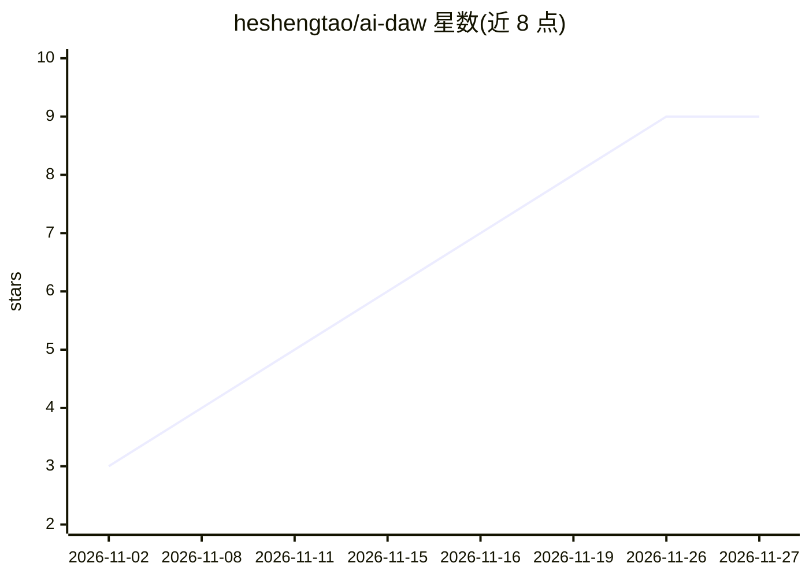

# heshengtao/ai-daw

⭐ 9 · Rust · Apache-2.0 · 推送 2026-11-25 · [GitHub](https://github.com/heshengtao/ai-daw) · 个人维护 · 中文 README

**可被 AI Agent 通过 MCP 操作的本地优先数字音频工作站**

本地优先的桌面数字音频工作站，提供多轨时间线、钢琴卷帘、混音器（send/bus）、自动化轨道、内置合成器及 VST3/CLAP/AU 插件宿主。内置 MCP 服务器经 Skill 教会任意 AI Harness 操作运行中的应用：读写工程/轨道/音符、混音、分析与导出 WAV，Agent 每次编辑进入 undo 历史并可回退。AI 功能全部本地运行：节拍检测、音频转 MIDI、降噪、分轨、零样本歌声合成与音色替换，CPU 默认，可选 CoreML/DirectML 加速。预编译二进制尚未发布，目前需源码构建或使用 Docker 镜像。

## 筛选速览

| 维度 | 判定 | 备注 |
|---|---|---|
| AI 角色 | `ai-enhanced` | 去掉 AI 部分产品仍成立 |
| 许可风险 | `permissive` | Apache-2.0 |
| 部署形态 | `desktop` | 安装包/桌面程序 |
| 模型依赖 | — | README 未给出锁定关系 |
| 硬件要求 | — | 无带数字的原话,不猜 |
| 安装摩擦 | `low` | 无编译、无系统依赖或容器化 |
| 成熟度 | — | 结构信号不足 |

## 能力要点

- 内置 MCP 服务器，Agent 经 Skill 直接操作会话，编辑可归因、可撤销
- 本地 AI：Basic Pitch/MuScriptor 音频转 MIDI、HTDemucs 分轨、SoulX-Singer 歌声与音色替换
- VST3/CLAP/AU 插件宿主与插件管理器，18 个内置采样乐器
- 无窗口运行并以浏览器访问同一会话，提供 Docker 镜像

## 适用场景

- 让 AI Agent 编曲、写音符、调混音并观察其操作过程
- 测试模型对作曲知识（编曲、配器、混音）的实际掌握
- 本地离线完成音频转 MIDI、人声降噪、分轨与歌声替换

## 场景标签

 · 领域:音频/音乐制作工具

## 证据(README 行号)

> L1: AI DAW — a local-first, AI-native digital audio workstation
> L18: It is a real DAW: a multi-track timeline, a piano roll, a mixer with sends and buses, automation lanes, a built-in 
> L130: Pre-built binaries will be published on the GitHub Releases page. Until then, build from source.

## 星数曲线

2026-11-02 3 → 2026-11-27 9（+6）

---
*卡片 v1 · prompt 1.4 · 生成 2026-11-20 · 置信度 high · 依据 README sha `8d689742369f` · [字段定义](../../DATASET.md)*
