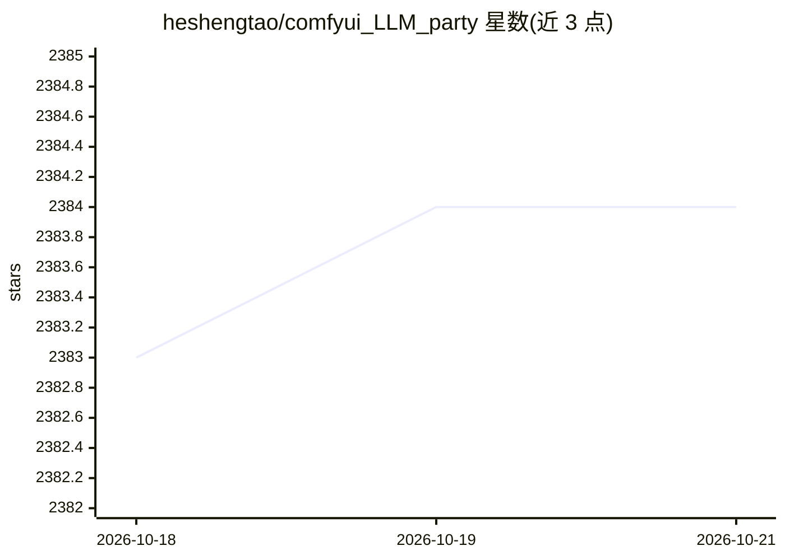

# heshengtao/comfyui_LLM_party

⭐ 2,384 · Python · AGPL-3.0 · 推送 2026-07-29 · [GitHub](https://github.com/heshengtao/comfyui_LLM_party) · 个人维护 · 中文 README

**ComfyUI 里的 LLM 工作流节点集：搭建 Agent/RAG/多模态工作流**

基于 ComfyUI 前端构建 LLM 工作流的节点集合，功能覆盖多工具调用、角色设定、词向量 RAG 与 GraphRAG 知识库管理、单/多 Agent 流水线与环形交互、接入 QQ/飞书/Discord、LLM+TTS+ComfyUI 串联工作流及 MCP server 连接。模型接入方式包括 OpenAI 格式 API（含中转）、aisuite 兼容 API、ollama 托管本地模型、transformers 与 GGUF 格式本地 LLM/VLM。通过 ComfyUI Manager、git clone 或 zip 解压安装，需 pip 安装依赖；提供 Windows 便携包与模型下载地址。

## 筛选速览

| 维度 | 判定 | 备注 |
|---|---|---|
| AI 角色 | `ai-ecosystem` | LLM/agent 周边工具 |
| 许可风险 | `viral` | AGPL-3.0 |
| 部署形态 | `desktop` | 安装包/桌面程序 |
| 模型依赖 | local-ok | 支持本地模型 |
| 硬件要求 | — | 无带数字的原话,不猜 |
| 安装摩擦 | `low` | 无编译、无系统依赖或容器化 |
| 成熟度 | — | 结构信号不足 |

## 能力要点

- 支持 OpenAI 格式与 aisuite 接口调用多家 LLM，含 ollama/llama.cpp 本地方案
- 本地加载 transformers 库模型与 GGUF 格式 LLM/VLM
- MCP 工具节点将 MCP server 的工具转换为 LLM 可调用工具
- 词向量 RAG、GraphRAG 知识库与多 Agent 环形/辐射交互构建

## 适用场景

- 在 ComfyUI 中把 LLM 能力接入现有图像工作流
- 搭建带知识库的专属 AI 助手并接入 QQ/飞书/Discord
- 本地部署 LLM/VLM/GGUF 模型进行多模态生成

## 场景标签

`多智能体` `RAG` `工作流自动化` `AI 助手` · 领域:Agent 开发

## 证据(README 行号)

> L15: C‌‌​‎​‎‏​‍‎​‎​‎‏​‌‎​‎‍​‍‏​‍‌​‌‏omfyui_llm_party aims to develop a complete set of nodes for LLM workfl
> L22: ComfyUI LLM Party, from the most basic LLM multi-tool call, role setting to quickly build your own exclusive AI ass
> L50: 1. The MCP tool has been updated. You can modify the configuration in the 'mcp_config.json' file located in the par

## 星数曲线

2026-10-18 2,383 → 2026-10-21 2,384（+1）

---
*卡片 v1 · prompt 1.4 · 生成 2026-10-21 · 置信度 mid · 依据 README sha `0f32ad808852` · [字段定义](../../DATASET.md)*
