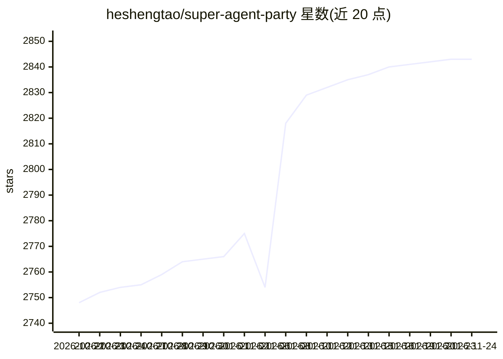

# heshengtao/super-agent-party

⭐ 2,843 · JavaScript · AGPL-3.0 · 推送 2026-10-27 · [GitHub](https://github.com/heshengtao/super-agent-party) · [官网](https://www.agentparty.top) · 个人维护 · 中文 README

**自托管桌面 AI 伴侣：聊天、控制电脑、接入 IM 与直播**

一个桌面 AI 伴侣应用：支持自定义 VRM/Live2D 模型、3D 场景、角色人格与长期记忆的多角色群聊；通过桌面视觉与鼠标/键盘/终端工具链让 agent 操作计算机；任务中心支持 MCP 与 Agent Skills 后台执行；可一键部署为 QQ、微信、飞书、Telegram、Discord 等 IM 机器人及 Bilibili、YouTube、Twitch 直播机器人。提供开放 OpenAI 兼容 API 与 MCP 接口供外部调用，并有插件扩展系统。Windows/macOS(M 芯片)/Linux 提供安装包，另支持 Docker 与源码部署。

## 筛选速览

| 维度 | 判定 | 备注 |
|---|---|---|
| AI 角色 | `ai-native` | 本体是模型或模型工具 |
| 许可风险 | `viral` | AGPL-3.0 |
| 部署形态 | `desktop` | 安装包/桌面程序 |
| 模型依赖 | — | README 未给出锁定关系 |
| 硬件要求 | — | 无带数字的原话,不猜 |
| 安装摩擦 | `low` | 无编译、无系统依赖或容器化 |
| 成熟度 | — | 结构信号不足 |

## 能力要点

- 桌面视觉+鼠标/键盘/终端工具链实现 AI 控制电脑
- 一键部署至 7 种 IM 平台与 3 个直播平台
- 开放 OpenAI 兼容 API 与 MCP 接口，可被外部 agent 接入
- 插件扩展系统（AI 编辑器、galgame、塔罗、PPT 等 17 个示例扩展）

## 适用场景

- 搭建带 2D/3D 虚拟形象的桌面 AI 伴侣
- 让 AI 伴侣在后台自动操作电脑完成任务
- 把 AI 助手接入微信群、Discord 或直播间互动
- 通过 OpenAI 兼容 API 把智能体能力接入自己的应用

## 场景标签

`AI 助手` `Agent 记忆` `GUI 自动化` · 领域:Agent 开发

## 证据(README 行号)

> L44: ### 🚀 **An AI desktop companion with endless possibilities!**
> L55: #### Task Center: Enable your AI agents to perform any advanced tasks in the background, automatically control your
> L67: #### Instant Messaging Bot: Supports one-click deployment to QQ, WeChat, Feishu, DingTalk, Telegram, Discord, Slack
> L79: #### Developer-Friendly: Offers open OpenAI API interfaces and MCP interfaces, allowing agents to be externally con

## 星数曲线

2026-10-22 2,748 → 2026-11-24 2,843（+95）

---
*卡片 v1 · prompt 1.4 · 生成 2026-11-23 · 置信度 high · 依据 README sha `7ad6428ff4c7` · [字段定义](../../DATASET.md)*
