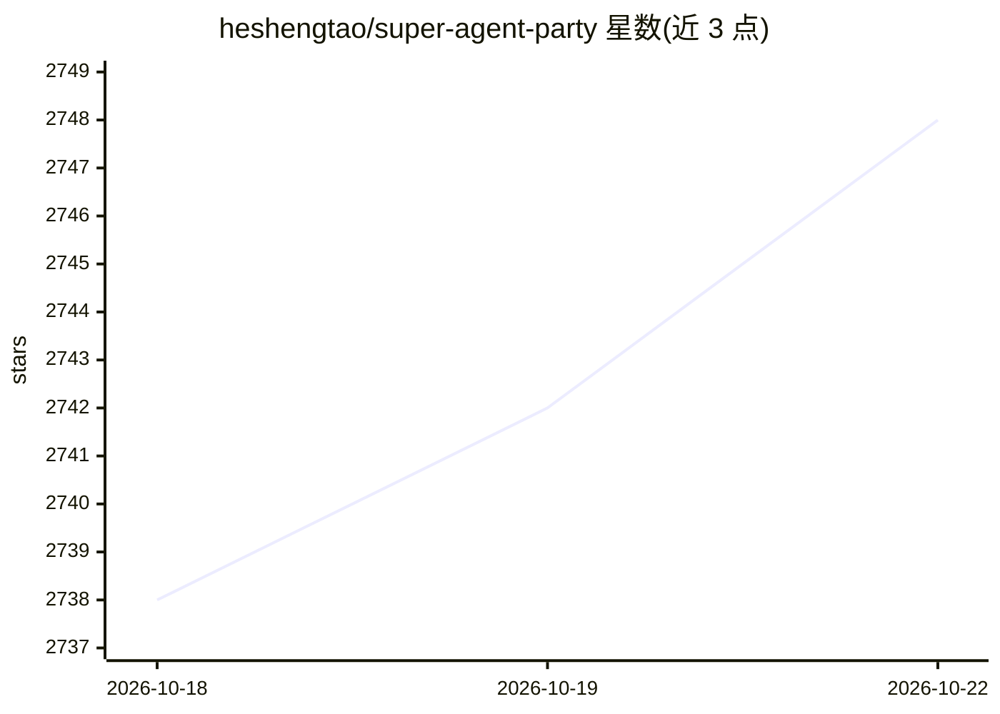

# heshengtao/super-agent-party

⭐ 2,748 · JavaScript · AGPL-3.0 · 推送 2026-10-18 · [GitHub](https://github.com/heshengtao/super-agent-party) · [官网](https://www.agentparty.top) · 个人维护 · 中文 README

**给个人用户的全能 AI 桌面伴侣：聊天、直播、IM bot、电脑控制**

面向终端用户的 AI 伴侣应用：桌面 VRM/Live2D 形象陪伴聊天，支持多角色群聊与 tavern 角色卡；内建任务中心，agent 可后台执行任务、通过桌面视觉加鼠标键盘工具链控制电脑、自动操控浏览器。支持一键部署为 QQ/微信/飞书/Telegram/Discord 等 IM bot，以及 Bilibili/YouTube/Twitch 直播 bot。提供扩展系统，开放 OpenAI 格式 API 与 MCP 接口供外部接入。模型全部可选，可接本地引擎或云端 API，硬件要求低（2 核 2G 即可）。提供 Windows 安装包/便携版、macOS（仅 M 芯片）、Linux AppImage、Docker 及源码部署。

## 筛选速览

| 维度 | 判定 | 备注 |
|---|---|---|
| AI 角色 | `ai-native` | 本体是模型或模型工具 |
| 许可风险 | `viral` | AGPL-3.0 |
| 部署形态 | `desktop` | 安装包/桌面程序 |
| 模型依赖 | local-ok | 支持本地模型 |
| 硬件要求 | — | 无带数字的原话,不猜 |
| 安装摩擦 | `low` | 无编译、无系统依赖或容器化 |
| 成熟度 | — | 结构信号不足 |

## 能力要点

- 桌面视觉+鼠标键盘终端工具链的电脑控制能力
- 一键部署到 QQ/微信/飞书/Discord 等 7 个 IM 平台及直播平台
- VRM/Live2D 桌面形象、多角色群聊与长期记忆
- 开放 OpenAI 格式 API 与 MCP 接口，附扩展系统与官方插件列表

## 适用场景

- 在桌面养一个可对话、可代办任务的 AI 伴侣
- 让 AI 代替我在 Bilibili/YouTube 等平台做直播 bot
- 把 AI 助手一键部署到 QQ/Discord 等 IM 群里
- 让 agent 后台自动操作电脑和浏览器完成工作

## 场景标签

`AI 助手` `GUI 自动化` `浏览器自动化` · 领域:效率与自动化

## 证据(README 行号)

> L44: ### 🚀 **An AI desktop companion with endless possibilities!**
> L52: #### High-freedom chat interface: custom background images, emoji packs, character personas, THA-based 2D character
> L58: #### Computer Control: Through desktop vision combined with a toolchain for controlling the mouse, keyboard, and te

## 星数曲线

2026-10-18 2,738 → 2026-10-22 2,748（+10）

---
*卡片 v1 · prompt 1.4 · 生成 2026-10-21 · 置信度 high · 依据 README sha `f903d025844b` · [字段定义](../../DATASET.md)*
