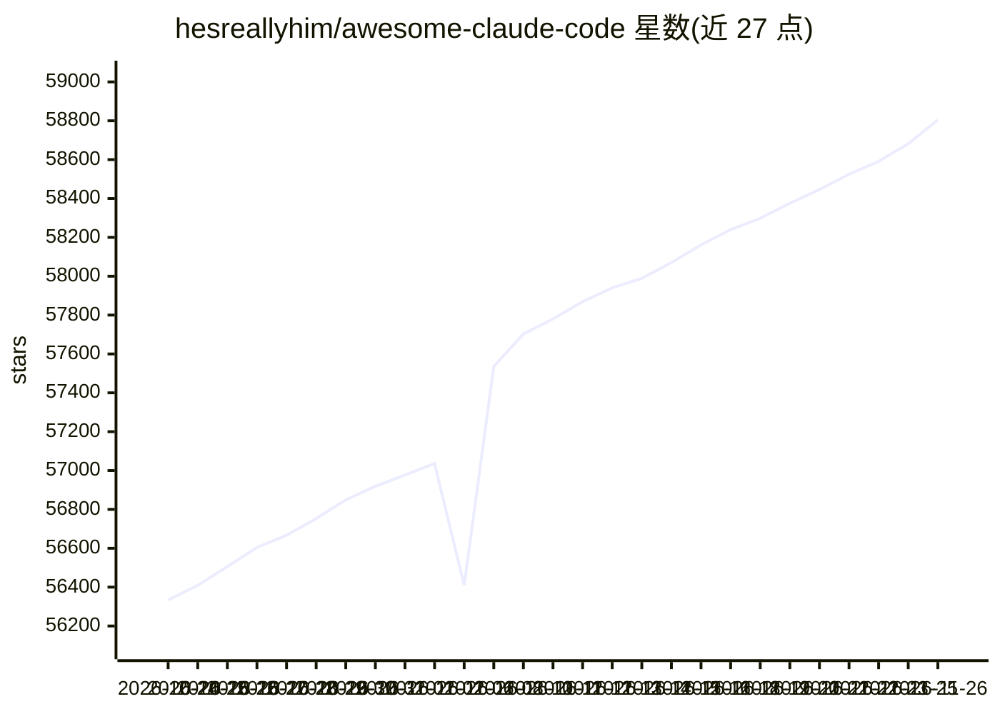

# hesreallyhim/awesome-claude-code

⭐ 58,804 · Python · NOASSERTION · 推送 2026-11-25 · [GitHub](https://github.com/hesreallyhim/awesome-claude-code) · 个人维护

**为 Claude Code 用户策展的技能、代理、插件与教程资源清单**

围绕 Claude Code 的精选资源清单，收录官方文档（Agent Skills、最佳实践、GitHub Action、安全审查等）与社区项目，按入门指南、文档学习、技能等目录组织，条目附创建时间、最近提交、许可证与星标元数据。收录对象包括 skills、agents、statuslines、开发者工具与插件，设有近期新增与 GitHub 项目速览栏目；当前版本为重构后的新列表，旧条目保留在 README_ALTERNATIVES 目录并将逐步迁回。

## 筛选速览

| 维度 | 判定 | 备注 |
|---|---|---|
| AI 角色 | `ai-knowledge` | 知识聚合/清单类 |
| 许可风险 | `none` | NOASSERTION |
| 部署形态 | `library` | 以包/库形式分发 |
| 模型依赖 | — | README 未给出锁定关系 |
| 硬件要求 | — | 无带数字的原话,不猜 |
| 安装摩擦 | `low` | 无编译、无系统依赖或容器化 |
| 成熟度 | — | 结构信号不足 |

## 动量与使用信号

- 维护:`active` — 距上次 push 0.7 天,年发版 0,14 位贡献者
- 涨星:近 1 天 **+92**(自 20261016 起算)
- 平台:— · 协议:MCP / OLLAMA

## 能力要点

- 收录 Anthropic 官方资源：Agent Skills、Best Practices、Cheatsheet、GitHub Action 等
- 条目附带 created/last-commit/license/stars 元数据
- 覆盖 skills、subagents、hooks、MCP、plugins 等 Claude Code 扩展机制的资源
- 旧版条目保留于 README_ALTERNATIVES 并计划迁回

## 适用场景

- 上手 Claude Code 时查找系统化教程与入门指南
- 为项目寻找可安装的 Claude Code 技能与插件
- 了解 Claude Code 生态的官方文档与工作流模式

## 场景标签

`精选清单` `教程课程` · 领域:学习与行业

## 证据(README 行号)

> L1: Awesome Claude Code
> L5: _A hand-picked collection of the finest of resources for the most awesome of agents, Claude Code, the undisputed cha
> L17: # Table of Contents

## 星数曲线

2026-10-24 56,334 → 2026-11-26 58,804（+2,470）

---
*卡片 v1 · prompt 1.4 · 生成 2026-11-22 · 置信度 mid · 依据 README sha `680c995c9755` · [字段定义](../../DATASET.md)*
