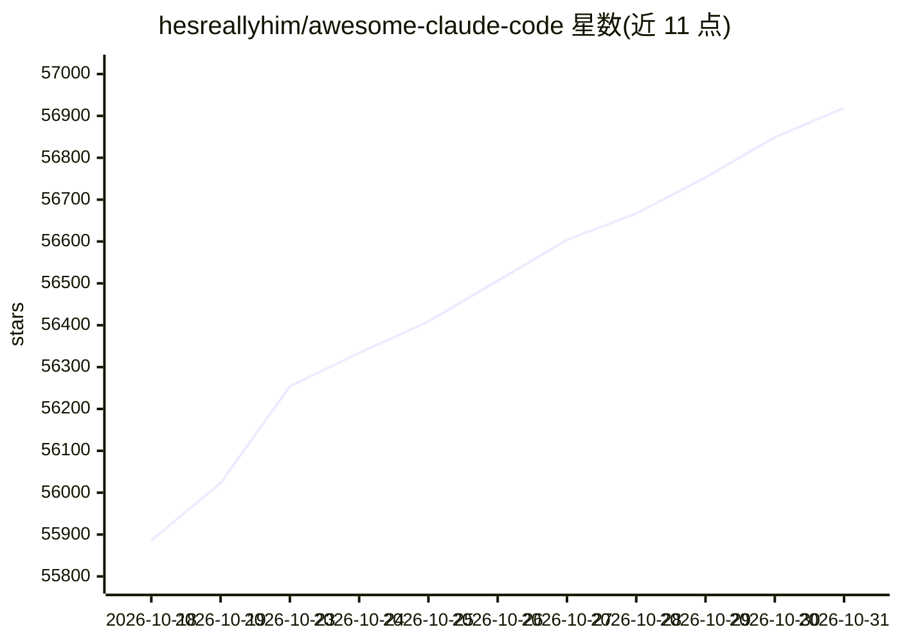

# hesreallyhim/awesome-claude-code

⭐ 56,919 · Python · NOASSERTION · 推送 2026-10-30 · [GitHub](https://github.com/hesreallyhim/awesome-claude-code) · 个人维护

**Claude Code 生态资源精选清单（awesome list）**

人工精选的 Claude Code 相关资源聚合清单：收录入门指南、Anthropic 官方文档与仓库、技能（skills）、插件、hooks、subagents、系统提示词镜像、Android 运行指南等类别的第三方项目，每条附简介。当前版本为新格式重构的过渡状态，旧条目保存在 README_ALTERNATIVES 目录且不再更新，将逐步迁移回主列表。面向 Claude Code 的使用者与扩展开发者，用于发现学习资料与生态工具。

## 筛选速览

| 维度 | 判定 | 备注 |
|---|---|---|
| AI 角色 | `ai-knowledge` | 知识聚合/清单类 |
| 许可风险 | `none` | NOASSERTION |
| 部署形态 | `library` | 以包/库形式分发 |
| 模型依赖 | — | README 未给出锁定关系 |
| 硬件要求 | — | 无带数字的原话,不猜 |
| 安装摩擦 | `low` | 无编译、无系统依赖或容器化 |
| 成熟度 | `idea` | |

## 动量与使用信号

- 维护:`active` — 距上次 push 0.7 天,年发版 0,14 位贡献者
- 涨星:近 1 天 **+92**(自 20261016 起算)
- 平台:— · 协议:MCP / OLLAMA

## 能力要点

- 按 Start Here / From Anthropic / 文档与学习等类别组织条目
- 收录官方 Agent Skills 仓库、官方插件目录等 Anthropic 资源
- 旧版条目保留于 README_ALTERNATIVES 目录（不更新，待迁移）
- 提供 Claude Code 项目 Ticker 与 Recently Added 区块

## 适用场景

- 查找 Claude Code 的入门与进阶学习资料
- 发现可安装的 skills、插件与 hooks 等扩展资源
- 跟踪 Anthropic 官方发布的 Claude Code 相关文档与工具

## 场景标签

`精选清单` · 领域:学习与行业

## 证据(README 行号)

> L1: Awesome Claude Code
> L5: _A hand-picked collection of the finest of resources for the most awesome of agents, Claude Code, the undisputed cha
> L17: # Table of Contents

## 星数曲线

2026-10-18 55,886 → 2026-10-31 56,919（+1,033）

---
*卡片 v1 · prompt 1.4 · 生成 2026-10-20 · 置信度 mid · 依据 README sha `42102114d951` · [字段定义](../../DATASET.md)*
