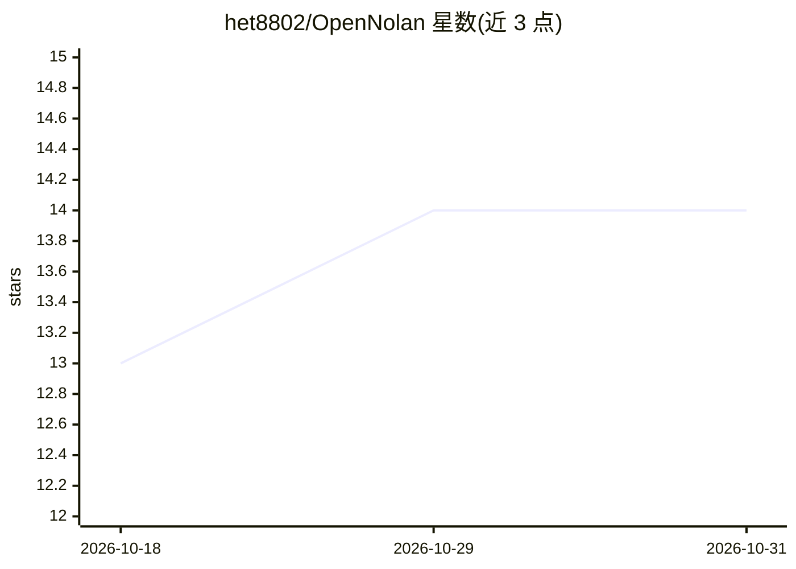

# het8802/OpenNolan

⭐ 14 · Python · NOASSERTION · 推送 2026-08-19 · [GitHub](https://github.com/het8802/OpenNolan) · [官网](https://www.opennolan.com) · 个人维护

**开源短视频自动剪辑引擎：AI agent 生成竖版 Reels/TikTok 成片**

面向内容创作者的开源短视频生产引擎：用户给出主题、脚本或参考视频，AI agent 执行研究→脚本→场景规划→素材→剪辑→合成的完整流程，产出含口播、音乐、SFX、逐字字幕与调色的 9:16 竖版成片。提供 Web 可视化编辑器（Mission Control）与 AI 编程助手两种使用方式；支持 FFmpeg/Remotion/HyperFrames 三种渲染运行时。零 API key 即可用免费素材、本地 TTS 与 FFmpeg 剪辑；依赖 Python 3.10+、FFmpeg、Node.js 18+。

## 筛选速览

| 维度 | 判定 | 备注 |
|---|---|---|
| AI 角色 | `ai-native` | 本体是模型或模型工具 |
| 许可风险 | `none` | NOASSERTION |
| 部署形态 | `library` | 以包/库形式分发 |
| 模型依赖 | — | README 未给出锁定关系 |
| 硬件要求 | — | 无带数字的原话,不猜 |
| 安装摩擦 | `high` | 编译与系统依赖俱全 |
| 成熟度 | — | 结构信号不足 |

## 能力要点

- 完整 agent 流水线：研究→脚本→素材→剪辑→渲染竖版成片
- Web 可视化编辑器（时间线、关键帧、实时预览）与 AI 助手双入口
- 零 API key 可用：免费素材、本地 TTS（piper）、FFmpeg 剪辑与逐字字幕
- 三种渲染运行时：FFmpeg / Remotion / HyperFrames，GPU 可解锁本地视频生成（Wan2.1 等）

## 适用场景

- 从主题或参考视频一键生成 Instagram Reels / TikTok / YouTube Shorts 成片
- 把播客或长视频切成多条短片段二次分发
- 在可视化时间线里手动微调 AI 生成剪辑后导出

## 场景标签

`视频生成` `图像视频处理` · 领域:内容生成

## 证据(README 行号)

> L20: Tell it the short-form video you want. OpenNolan's AI agent researches the hook, writes and voices the script, find
> L101: Either way, the agent researches the topic with live web search, writes and narrates the script with voice directi

## 星数曲线

2026-10-18 13 → 2026-10-31 14（+1）

---
*卡片 v1 · prompt 1.4 · 生成 2026-10-31 · 置信度 high · 依据 README sha `353cdae38b29` · [字段定义](../../DATASET.md)*
