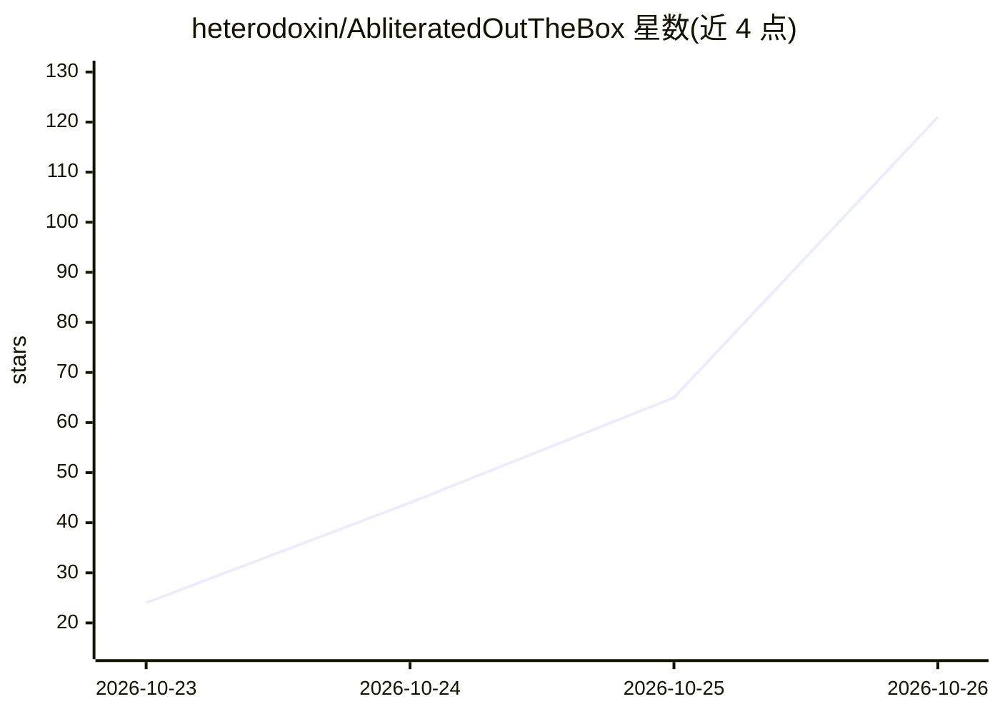

# heterodoxin/AbliteratedOutTheBox

⭐ 121 · C++ · MIT · 推送 2026-10-24 · [GitHub](https://github.com/heterodoxin/AbliteratedOutTheBox) · 个人维护

**llama.cpp fork：推理时消除模型拒答，不改权重文件**

llama.cpp 的 fork，新增 llama-abliterate 运行时：对每个被判定为有害标记的提示，在推理时通过方向投影移除拒答方向与安全免责方向，使模型交付所请求内容；原始权重文件保持不变，无需训练或额外文件。方向从提示本身读取（强制 comply/refuse 开头差分激活），look-ahead 门控按提示决定是否触发；编辑发生在 build_cvec 层输出位置，覆盖 165 种架构中的 131 种，无需逐模型代码。通过 CMake 从源码编译，支持 CUDA/HIP/CPU 后端。已知限制：一次只编辑一个序列，过强的 disc-strength 可能使长输出退化。

## 筛选速览

| 维度 | 判定 | 备注 |
|---|---|---|
| AI 角色 | `ai-ecosystem` | LLM/agent 周边工具 |
| 许可风险 | `permissive` | MIT |
| 部署形态 | `None` |  |
| 模型依赖 | — | README 未给出锁定关系 |
| 硬件要求 | `cpu-ok` | |
| 安装摩擦 | `medium` | 含编译或系统依赖之一 |
| 成熟度 | — | 结构信号不足 |

## 能力要点

- 推理时消融拒答方向，原始权重文件不变，无需训练或额外文件
- look-ahead 门控按提示触发，未触发时输出与原模型位级一致
- 单一路径覆盖 131 种共享 build_cvec 位置的模型架构
- 提供 --ff-threshold / --edit-strength / --disc-strength 可调参数

## 适用场景

- 研究模型拒答机制与消融技术的研究者复现实验
- 在已有 llama.cpp 环境上测试推理时消融效果
- 评估拒答方向移除对良性提示输出的影响

## 场景标签

`推理引擎` · 领域:训练与推理

## 证据(README 行号)

> L1: AbliteratedOutTheBox
> L7: AbliteratedOutTheBox is a fork of llama.cpp that gets any supported model to answer flagged harmful prompts, deliver
> L33: It runs with nothing to set up and nothing to download beyond the model itself: no fit, no sidecar, no second file,

## 星数曲线

2026-10-23 24 → 2026-10-26 121（+97）

---
*卡片 v1 · prompt 1.4 · 生成 2026-10-24 · 置信度 high · 依据 README sha `97d4d5fb4ca1` · [字段定义](../../DATASET.md)*
