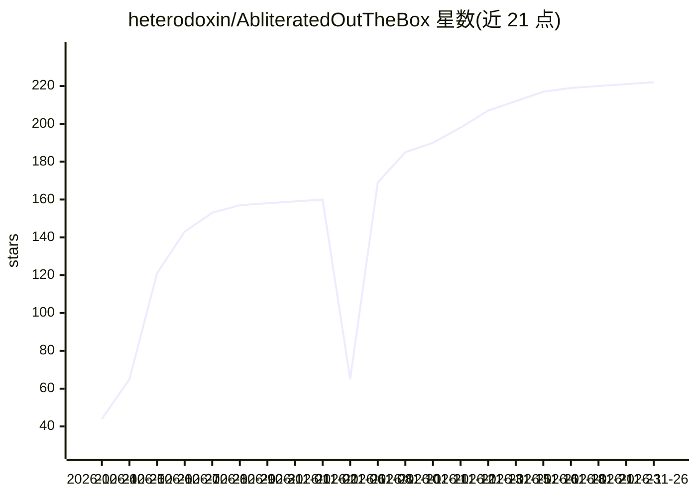

# heterodoxin/AbliteratedOutTheBox

⭐ 222 · C++ · MIT · 推送 2026-11-22 · [GitHub](https://github.com/heterodoxin/AbliteratedOutTheBox) · 个人维护

**推理时消融拒绝行为的 llama.cpp fork 工具**

llama.cpp 的 fork，在推理时对激活做编辑以减少模型拒答与免责声明输出，不改模型权重。每次提示由 llama-abliterate 测量 comply/refuse 与 clean/disclaimer 开头差值方向，用门控机制决定是否施加编辑，无需训练、语料校准或第二模型。从源码用 CMake 构建，需 C++17 编译器、Make、OpenSSL 开发文件与 GGUF 模型。门控未触发时输出与基线一致；编辑强度等参数可调。

## 筛选速览

| 维度 | 判定 | 备注 |
|---|---|---|
| AI 角色 | `ai-native` | 本体是模型或模型工具 |
| 许可风险 | `permissive` | MIT |
| 部署形态 | `None` |  |
| 模型依赖 | — | README 未给出锁定关系 |
| 硬件要求 | — | 无带数字的原话,不猜 |
| 安装摩擦 | `medium` | 含编译或系统依赖之一 |
| 成熟度 | — | 结构信号不足 |

## 能力要点

- 推理时激活编辑，不修改模型权重、无需训练或校准数据
- 共享 build_cvec 图钩子，复用 llama.cpp CPU/GPU 后端
- 提供 --ff-threshold/--edit-strength 等可调参数控制门控与编辑强度
- README 明确声明未声称任何基准拒答率并列举已知局限

## 适用场景

- 在不生成新模型检查点的情况下测试运行时拒绝行为编辑
- 基于现有 GGUF 模型做推理时的激活方向实验
- 对比编辑开启与关闭时同一模型在同一聊天模板下的输出差异

## 场景标签

`推理引擎` · 领域:训练与推理

## 证据(README 行号)

> L7: AbliteratedOutTheBox is a fork of llama.cpp that attempts to reduce refusals and safety disclaimers through inferenc
> L9: ## Install

## 星数曲线

2026-10-24 44 → 2026-11-26 222（+178）

---
*卡片 v1 · prompt 1.4 · 生成 2026-11-25 · 置信度 high · 依据 README sha `953f4e8d9332` · [字段定义](../../DATASET.md)*
