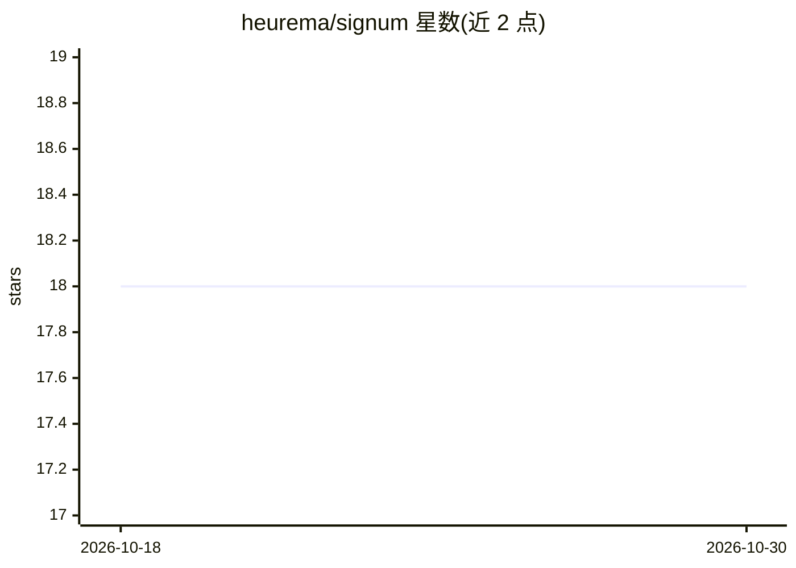

# heurema/signum

⭐ 18 · Shell · MIT · 推送 2026-07-20 · [GitHub](https://github.com/heurema/signum) · [官网](https://skill7.dev/signum) · 个人维护

**面向 agentic 开发流程的合约式审查与证明门禁（Claude Code 插件）**

Signum 是一个以合约为先的证明门禁：把任务转化为经过审查的合约（CONTRACT），按合约执行（EXECUTE），审计确定性与模型辅助的证据（AUDIT），并打包人类和 CI 可检查的证明包（PACK）。以 Claude Code 插件形式安装，也提供 Codex App 插件元数据；提供 /signum 命令面、契约产物目录与 GitHub Actions 门禁模板（proofpack 决策映射为退出码）。自身定位为实验性基线，非生产认证系统。依赖本地 bash/git/jq/python3 工具链。

## 筛选速览

| 维度 | 判定 | 备注 |
|---|---|---|
| AI 角色 | `ai-ecosystem` | LLM/agent 周边工具 |
| 许可风险 | `permissive` | MIT |
| 部署形态 | `None` |  |
| 模型依赖 | — | README 未给出锁定关系 |
| 硬件要求 | — | 无带数字的原话,不猜 |
| 安装摩擦 | `low` | 无编译、无系统依赖或容器化 |
| 成熟度 | `idea` | |

## 能力要点

- CONTRACT → EXECUTE → AUDIT → PACK 四阶段流水线
- proofpack 决策映射 CI 退出码（0/1/78）并可上传产物、评论 PR
- 同时提供 Claude Code 与 Codex App 两种插件安装途径
- 契约产物包含 contract.json、combined.patch、audit_summary.json、proofpack.json

## 适用场景

- 在 agentic 编码变更合入前生成可审查的证据包
- 在 CI 中以门禁阻塞或转人工审查高风险变更
- 为项目引导 /signum:init 上下文与 harness 文档

## 场景标签

`代码审查` · 领域:编码与开发

## 证据(README 行号)

> L3: Signum is a contract-first proof gate for agentic software changes: it turns a task into a reviewed contract, execut
> L37: For Claude Code, install the plugin from the Emporium marketplace:

## 星数曲线

2026-10-18 18 → 2026-10-30 18（+0）

---
*卡片 v1 · prompt 1.4 · 生成 2026-10-29 · 置信度 high · 依据 README sha `268dc3770524` · [字段定义](../../DATASET.md)*
