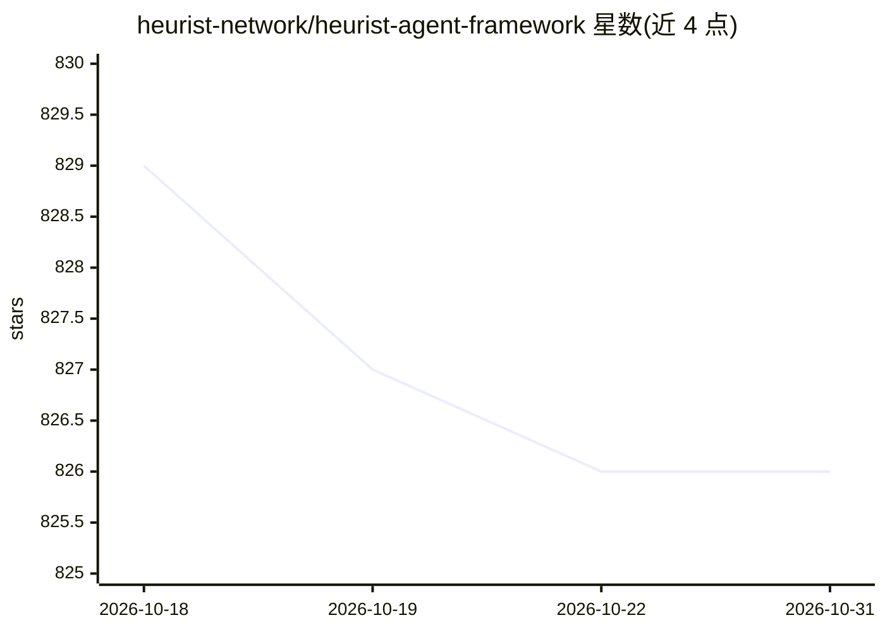

# heurist-network/heurist-agent-framework

⭐ 826 · Python · NOASSERTION · 推送 2026-10-24 · [GitHub](https://github.com/heurist-network/heurist-agent-framework) · [官网](https://agent.heurist.ai/) · 组织维护

**多接口 AI agent 框架：构建带推理、工具与记忆的智能体**

模块化组件架构的 AI agent 框架，支持通过 Telegram、Discord、Twitter、Farcaster、REST API 与 MCP 等多平台交互。提供 PersonalityProvider、KnowledgeProvider、LLMProvider 等组件，内置 RAG、思维链与深度研究三种工作流，支持图像生成、语音转录与 TTS、PostgreSQL/SQLite 向量存储。可访问 Heurist Mesh 中 30+ 个 Web3 专门 agent（加密分析、链上数据等），经 REST、x402 付费或 MCP 接入。开发环境用 uv 管理依赖，许可为 BSL 1.1。

## 筛选速览

| 维度 | 判定 | 备注 |
|---|---|---|
| AI 角色 | `ai-ecosystem` | LLM/agent 周边工具 |
| 许可风险 | `none` | NOASSERTION |
| 部署形态 | `None` |  |
| 模型依赖 | — | README 未给出锁定关系 |
| 硬件要求 | — | 无带数字的原话,不猜 |
| 安装摩擦 | `low` | 无编译、无系统依赖或容器化 |
| 成熟度 | — | 结构信号不足 |

## 能力要点

- 模块化组件系统（人格/知识/LLM/媒体处理等 7 类组件）
- RAG、Chain of Thought、Research 三种工作流
- 6 种多平台接口：Telegram/Discord/Twitter/Farcaster/REST/MCP
- 接入 Heurist Mesh 的 30+ Web3 专门 agent

## 适用场景

- 构建跨 Telegram/Discord 等多平台运行的 AI agent
- 为应用或 agent 接入 Web3 数据与加密分析能力
- 搭建带 RAG 与深度研究工作流的智能体服务

## 场景标签

`Agent 框架` · 领域:Agent 开发

## 证据(README 行号)

> L5: A flexible multi-interface AI agent framework that can interact through various platforms including Telegram, Discor
> L115: Heurist Core provides a set of core components, tools, and workflows for building LLM-powered agents or agentic ap

## 星数曲线

2026-10-18 829 → 2026-10-31 826（-3）

---
*卡片 v1 · prompt 1.4 · 生成 2026-10-21 · 置信度 high · 依据 README sha `a8d7416262cd` · [字段定义](../../DATASET.md)*
