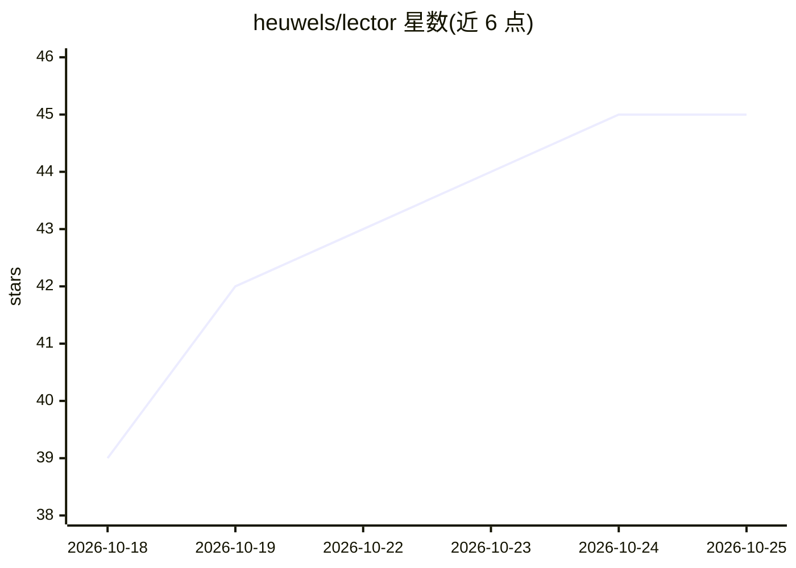

# heuwels/lector

⭐ 45 · TypeScript · AGPL-3.0 · 推送 2026-10-21 · [GitHub](https://github.com/heuwels/lector) · [官网](https://lector.dev) · 个人维护

**语言学习阅读器：导入 EPUB/YouTube，点词翻译、完形 SRS、同步 Anki**

面向语言学习者的自托管阅读与复习应用：导入 EPUB、Markdown、网页文章、YouTube 字幕、播客等文本，点词查看翻译并保存生词；按词频排序生成完形填空句子做间隔重复练习；通过 Lector Sync 插件或 AnkiConnect 与 Anki 双向同步。翻译与语法辅导可用本地词典、内置 Ollama 本地模型或 Anthropic 云端模型，无 API key 也可运行。一个 Docker Compose 文件即可自托管，数据存于单个 SQLite 文件；27 种语言包包含词典、词频数据与完形句库。

## 筛选速览

| 维度 | 判定 | 备注 |
|---|---|---|
| AI 角色 | `ai-enhanced` | 去掉 AI 部分产品仍成立 |
| 许可风险 | `viral` | AGPL-3.0 |
| 部署形态 | `self-host` | docker 或自建部署 |
| 模型依赖 | local-ok | 支持本地模型 |
| 硬件要求 | — | 无带数字的原话,不猜 |
| 安装摩擦 | `low` | 无编译、无系统依赖或容器化 |
| 成熟度 | — | 结构信号不足 |

## 能力要点

- 支持 EPUB/网页/YouTube 字幕/播客等多种导入源
- 内置 Ollama 本地模型服务，无 API key 也可运行
- Anki 双向同步（Lector Sync 插件或 AnkiConnect）
- 单个 Docker Compose 文件自托管，数据存于一个 SQLite 文件

## 适用场景

- 通过阅读沉浸式材料积累并复习目标语言词汇
- 把保存的生词发送到 Anki 做间隔重复复习
- 用 AI 导师批改目标语言写作并解答语法问题

## 场景标签

 · 领域:教育/语言学习

## 证据(README 行号)

> L3: Lector is a language-learning reader. It is an open-source alternative to
> L20: Optional local models run through the bundled Ollama service.
> L161: The app runs with no API keys. Claude is only required for rare words, phrase translation, and the tutor.

## 星数曲线

2026-10-18 39 → 2026-10-25 45（+6）

---
*卡片 v1 · prompt 1.4 · 生成 2026-10-25 · 置信度 high · 依据 README sha `24f35c90c044` · [字段定义](../../DATASET.md)*
