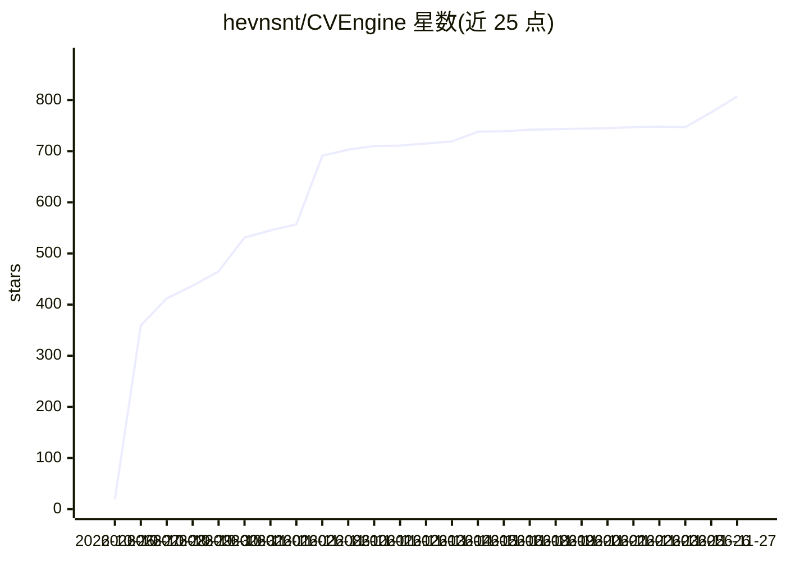

# hevnsnt/CVEngine

⭐ 807 · Python · GPL-3.0 · 推送 2026-11-26 · [GitHub](https://github.com/hevnsnt/CVEngine) · 个人维护

**自托管外部攻击面评估平台：持续发现资产并以证据验证漏洞**

cvENGINE 是一个自托管的外部攻击面与漏洞评估平台：输入域名后持续发现子域名、地址与证书，生成可按 Shodan 风格语法搜索的主机清单，用开源扫描器评估每个主机，并全天候读取多个 CVE 情报源，将新 CVE 与受影响版本的主机匹配。AI 功能默认关闭，需自带密钥或本地模型：AI 可起草只读检测、做误报分诊与复核，但系统验证与硬证据可覆盖模型结论；无模型时发现、扫描、匹配与验证功能仍可用。提供 MCP 服务器与 REST API 供开发者的 agent 接入。

## 筛选速览

| 维度 | 判定 | 备注 |
|---|---|---|
| AI 角色 | `ai-enhanced` | 去掉 AI 部分产品仍成立 |
| 许可风险 | `viral` | GPL-3.0 |
| 部署形态 | `self-host` | docker 或自建部署 |
| 模型依赖 | local-ok | 支持本地模型 |
| 硬件要求 | — | 无带数字的原话,不猜 |
| 安装摩擦 | `low` | 无编译、无系统依赖或容器化 |
| 成熟度 | — | 结构信号不足 |

## 能力要点

- 持续发现子域名/端口/证书，Shodan 风格可搜索清单
- 每小时读取 CISA KEV、EPSS 等多个 CVE 情报源并匹配受影响主机
- Sentinel 只读复检留存证据，硬证据设定模型不可越过下限
- AI 分诊/复核默认关闭，支持云端或本地模型，主机名脱敏

## 适用场景

- 把企业对外暴露的域名和资产纳入持续清点
- 新 CVE 出现后自动判断哪些主机真的受影响
- 用 AI 降低漏洞扫描的误报并留存验证证据
- 通过 MCP 让开发 agent 查询与驱动攻击面数据

## 场景标签

`网络安全` · 领域:学习与行业

## 证据(README 行号)

> L29: **Bring your own AI:** Anthropic, OpenAI or OpenRouter on your own key, or fully local with Ollama, LM Studio or vL
> L46: cvENGINE is a self-hosted external attack surface and vulnerability assessment platform. Give it your domains and i
> L107: |**AI (bring your own, off until you choose)**|Anthropic, OpenAI, OpenRouter, Ollama, LM Studio, vLLM|Finding tria

## 星数曲线

2026-10-26 19 → 2026-11-27 807（+788）

---
*卡片 v1 · prompt 1.4 · 生成 2026-11-24 · 置信度 high · 依据 README sha `3aeb0283c891` · [字段定义](../../DATASET.md)*
