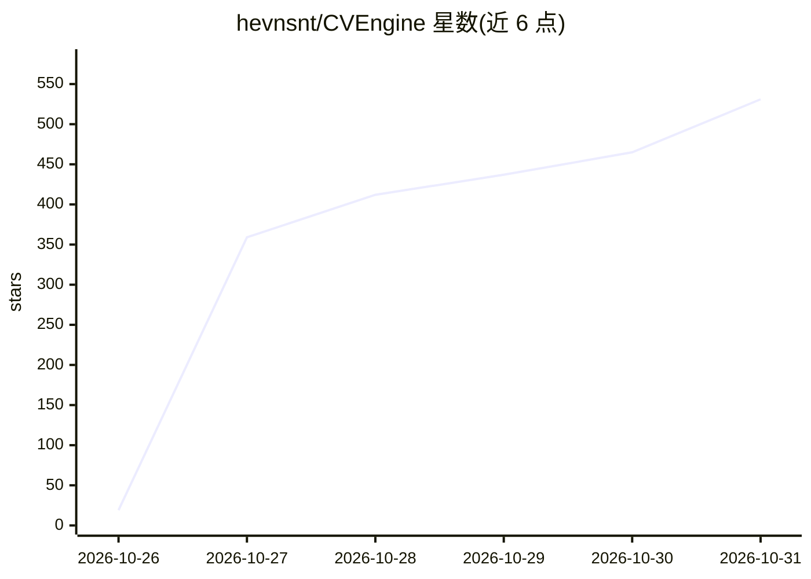

# hevnsnt/CVEngine

⭐ 531 · Python · GPL-3.0 · 推送 2026-10-30 · [GitHub](https://github.com/hevnsnt/CVEngine) · 个人维护

**自托管外部攻击面管理平台：资产发现、CVE 匹配与只读验证**

基于 Django/PostgreSQL 的自托管攻击面评估系统（reNgine 2.x 的 fork）：用 bbot/nmap/naabu/nuclei 持续发现资产、指纹服务版本，与 cve.now 等利用情报源按产品版本匹配，用只读检查验证漏洞，并以 Shodan 风格搜索、时间线和告警运营。AI 为可选增强：自带 Anthropic/OpenAI/OpenRouter/Ollama/vLLM key 做 triage、定向扫描与模板草拟，无模型时发现、扫描、匹配与验证仍可运行。提供 REST API 与 MCP server 供 agent 接入，含赏金工作台。单命令 Linux 安装脚本，Docker Compose 部署，GPL-3.0。

## 筛选速览

| 维度 | 判定 | 备注 |
|---|---|---|
| AI 角色 | `ai-enhanced` | 去掉 AI 部分产品仍成立 |
| 许可风险 | `viral` | GPL-3.0 |
| 部署形态 | `self-host` | docker 或自建部署 |
| 模型依赖 | local-ok | 支持本地模型 |
| 硬件要求 | — | 无带数字的原话,不猜 |
| 安装摩擦 | `low` | 无编译、无系统依赖或容器化 |
| 成熟度 | — | 结构信号不足 |

## 能力要点

- bbot/nmap/naabu/nuclei 持续资产发现与全端口后台扫描
- fire/smoke/ice 分级匹配 CISA KEV/ENISA/EPSS 等利用情报
- 只读验证（nuclei 模板/nmap/banner/数据库检查）记录确切命令
- 可选 BYO AI（Anthropic/OpenAI/OpenRouter/Ollama/vLLM）做 triage 与模板草拟，无模型仍可运行

## 适用场景

- 持续盘点自有互联网暴露资产并跟踪变化
- 判断今日被利用 CVE 是否命中我的环境并复现验证
- 通过 REST API/MCP 让 agent 在权限体系内查询资产与发现

## 场景标签

`网络安全` · 领域:学习与行业

## 证据(README 行号)

> L38: **Bring your own AI.** Anthropic, OpenAI, OpenRouter, Ollama, or vLLM, with keys stored encrypted. Without a model,
> L21: - **Verdicts, not noise.** AI triages your findings, read-only checks reproduce what they can, and fixed rules mean
> L117: Create a token on **API tokens and MCP** and send `Authorization: Bearer <token>` to `/api/v1/`, or connect an MCP

## 星数曲线

2026-10-26 19 → 2026-10-31 531（+512）

---
*卡片 v1 · prompt 1.4 · 生成 2026-10-27 · 置信度 high · 依据 README sha `4a98b93c0a7f` · [字段定义](../../DATASET.md)*
