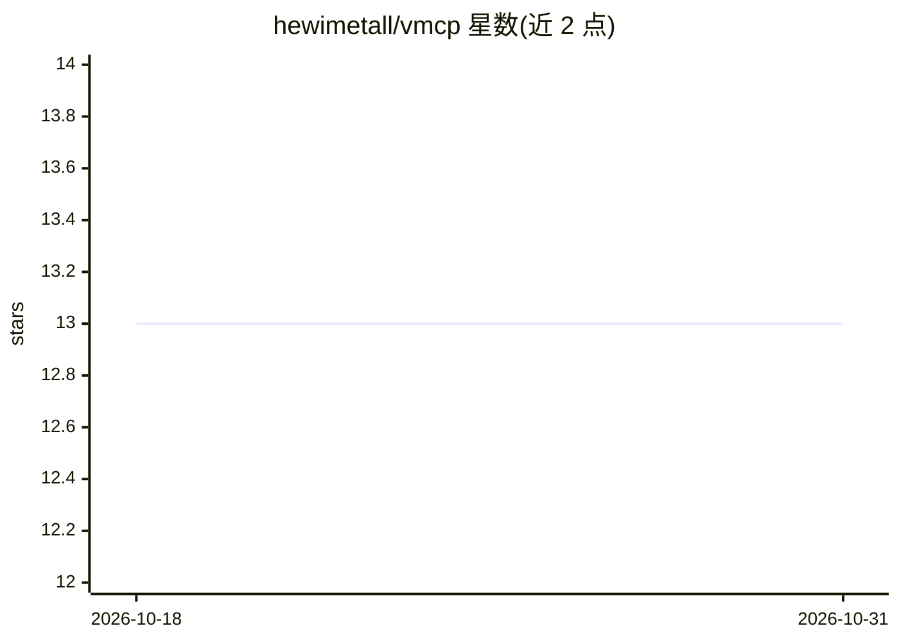

# hewimetall/vmcp

⭐ 13 · Rust · MIT · 推送 2026-09-19 · [GitHub](https://github.com/hewimetall/vmcp) · 个人维护

**Rust 编写的 MCP 网关：将多个上游 MCP 聚合为单一 GraphQL 端点**

用 Rust 实现的 MCP 网关，将多个上游 MCP 服务器聚合到单一 GraphQL 端点之后，agent 只需一次 query_graphql 调用即可路由请求，读操作并行、写操作顺序执行；schema 在启动时由上游 tools/list 动态构建。支持 OAuth 2.1 + PKCE + DCR 或静态 bearer token 认证、令牌与注册表热重载、基于 SQLite 的可选长任务、GCF 输出格式以及运维管理 API 与 Admin UI。通过 Docker 镜像或直接下载二进制运行，仅支持 HTTP 传输，stdio 场景需使用 vmcp-lite。

## 筛选速览

| 维度 | 判定 | 备注 |
|---|---|---|
| AI 角色 | `ai-ecosystem` | LLM/agent 周边工具 |
| 许可风险 | `permissive` | MIT |
| 部署形态 | `self-host` | docker 或自建部署 |
| 模型依赖 | — | README 未给出锁定关系 |
| 硬件要求 | — | 无带数字的原话,不猜 |
| 安装摩擦 | `low` | 无编译、无系统依赖或容器化 |
| 成熟度 | — | 结构信号不足 |

## 能力要点

- 单个 query_graphql 工具聚合多个上游 MCP 服务器，读并行/写顺序
- OAuth 2.1 + PKCE + DCR，或静态 bearer token（CI 场景）
- 令牌、registry.json 与 prompts 热重载，无需重启
- 基于 SQLite 的可选长任务（durable tasks）

## 适用场景

- 把多个 MCP 服务器统一暴露为一个端点给 agent 调用
- 对 MCP 网关的令牌与上游服务器进行运维管理
- CI 环境中使用不过期的静态 token 接入网关

## 场景标签

 · 领域:AI 基础设施/MCP 网关

## 证据(README 行号)

> L7: An MCP gateway written in Rust. It aggregates multiple upstream MCP servers behind a single GraphQL endpoint, allowi
> L11: - **One `query_graphql` tool** — send GraphQL and vmcp routes requests to the upstream servers. Reads run in parall

## 星数曲线

2026-10-18 13 → 2026-10-31 13（+0）

---
*卡片 v1 · prompt 1.4 · 生成 2026-10-31 · 置信度 high · 依据 README sha `715b71c78e37` · [字段定义](../../DATASET.md)*
