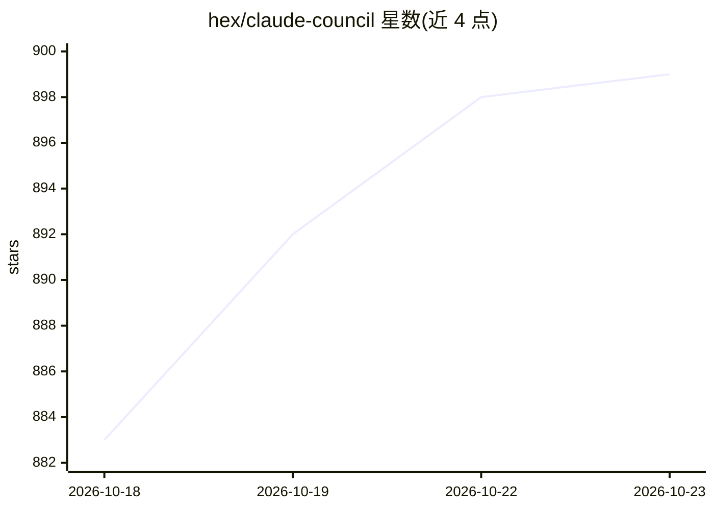

# hex/claude-council

⭐ 899 · Shell · MIT · 推送 2026-10-22 · [GitHub](https://github.com/hex/claude-council) · 个人维护

**Claude Code 插件：并行咨询多个 AI 编码代理并排对比回答**

运行在 Claude Code 内的插件：把同一个问题（可附最多 5 个相关文件，约 10,000 tokens）并行发给多个 AI 编码代理，在 tmux 侧栏或 Claude Code 内的面板中并排展示各家回答，再由 Claude 写出共识/分歧综合。提供方覆盖 API 密钥（OpenAI/Gemini/xAI/Perplexity/Kimi/OpenRouter）、订阅制 CLI（codex、antigravity、grok、kimi、cursor-agent）、本地 ollama，以及无任何提供方时的 Claude 子代理本地议会。明文保存全部提示与回答于 .claude/council-cache/，每家提供方只能读取自家环境变量。需要 curl 与 jq。

## 筛选速览

| 维度 | 判定 | 备注 |
|---|---|---|
| AI 角色 | `ai-ecosystem` | LLM/agent 周边工具 |
| 许可风险 | `permissive` | MIT |
| 部署形态 | `None` |  |
| 模型依赖 | local-ok | 支持本地模型 |
| 硬件要求 | — | 无带数字的原话,不猜 |
| 安装摩擦 | `low` | 无编译、无系统依赖或容器化 |
| 成熟度 | `idea` | |

## 能力要点

- 并行询问多家 AI 代理并排展示回答，Claude 生成综合
- 支持 API 密钥、订阅制 CLI、本地 ollama 与无密钥的本地议会四种接入方式
- 自动挑选最多 5 个相关文件作为上下文，可用 --file/--image 替换
- 提示与回答明文存于 .claude/council-cache/，提供方之间环境变量隔离

## 适用场景

- 架构决策或框架选型前交叉核验多个模型的意见
- 调试死角或安全审查时对比多家 AI 代理的回答
- 不额外付费，用订阅 CLI 或本地 ollama 组建多模型议会

## 场景标签

`多智能体` · 领域:Agent 开发

## 证据(README 行号)

> L3: A Claude Code plugin that consults multiple AI coding agents in parallel and shows you their answers side-by-side. U
> L105: - **Discovery.** Every provider with a key set, a CLI on `PATH` or a running
> L106:  `ollama` joins by default. `/claude-council:status` shows which ones did.

## 星数曲线

2026-10-18 883 → 2026-10-23 899（+16）

---
*卡片 v1 · prompt 1.4 · 生成 2026-10-21 · 置信度 high · 依据 README sha `0e410efb41d2` · [字段定义](../../DATASET.md)*
