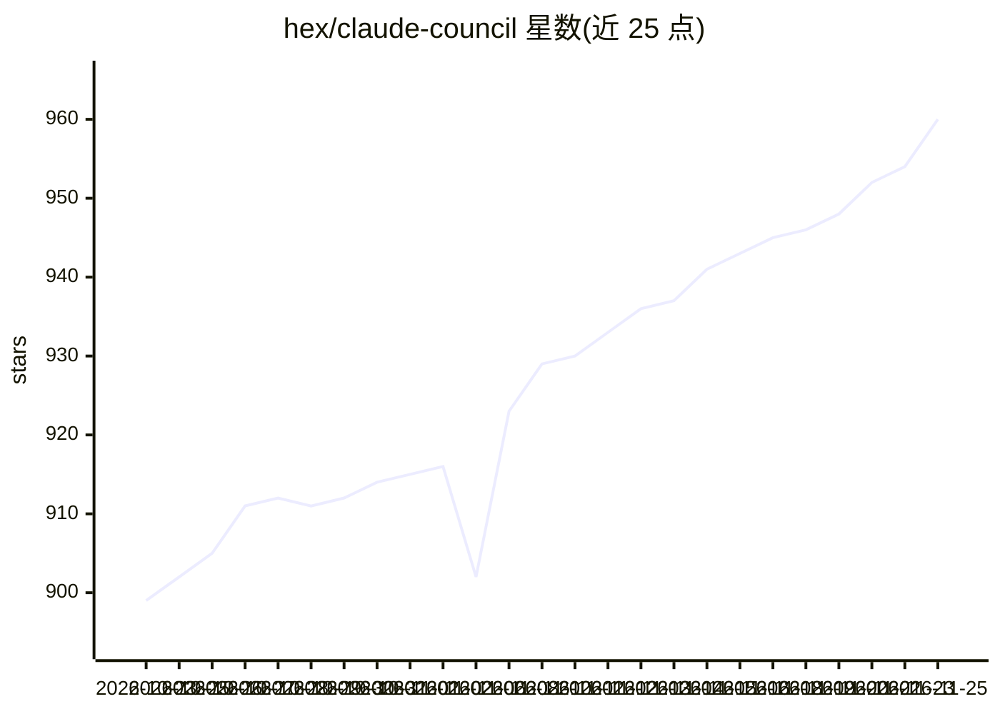

# hex/claude-council

⭐ 960 · Shell · MIT · 推送 2026-11-17 · [GitHub](https://github.com/hex/claude-council) · 个人维护

**给 Claude Code 用户的 AI 编码助手并行问询对比插件**

作为 Claude Code 插件运行，把同一个问题并行发给多个 AI 编码代理（API 密钥接入 Gemini/OpenAI/xAI/Perplexity/Kimi/OpenRouter，或订阅登录的 codex/antigravity/grok/kimi/cursor-agent CLI，或本地 ollama），各席位答案并排展示，Claude 写综合。运行在终端与 Claude Desktop Code 标签页，桌面普通聊天需另装 mcpb 扩展（仅 macOS/Linux）。至少需配置一个 provider 才能使用。

## 筛选速览

| 维度 | 判定 | 备注 |
|---|---|---|
| AI 角色 | `ai-ecosystem` | LLM/agent 周边工具 |
| 许可风险 | `permissive` | MIT |
| 部署形态 | `None` |  |
| 模型依赖 | local-ok | 支持本地模型 |
| 硬件要求 | — | 无带数字的原话,不猜 |
| 安装摩擦 | `low` | 无编译、无系统依赖或容器化 |
| 成熟度 | — | 结构信号不足 |

## 能力要点

- 多席位并行提问，支持 API 密钥、CLI 订阅登录与本地 ollama 三类接入
- Claude 生成跨模型一致/分歧综合，并标注可能改变结论的前提
- 支持角色分工、辩论模式、后台任务、答案导出与截图输入
- 内置 pane 面板实时观察各席位状态并重试失败席位

## 适用场景

- 架构决策（如 SQLite 还是 Postgres）前对比多个模型的意见
- 调试陷入死胡同时获取第二意见
- 安全审查与框架选型的多模型交叉验证

## 场景标签

`多智能体` `AI 助手` · 领域:Agent 开发

## 证据(README 行号)

> L3: A Claude Code plugin that asks AI coding agents the same question in
> L16: |Claude Code in a terminal|`/claude-council:ask`, every seat, and the pane beside the chat.|

## 星数曲线

2026-10-23 899 → 2026-11-25 960（+61）

---
*卡片 v1 · prompt 1.4 · 生成 2026-11-24 · 置信度 high · 依据 README sha `2c336150587e` · [字段定义](../../DATASET.md)*
