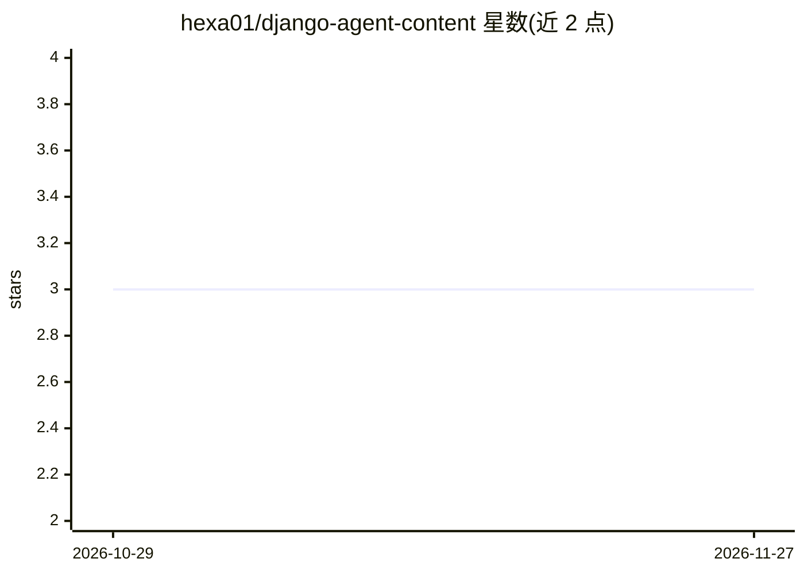

# hexa01/django-agent-content

⭐ 3 · Python · MIT · 推送 2026-10-31 · [GitHub](https://github.com/hexa01/django-agent-content) · 个人维护

**Django 应用：让 AI agent 通过 MCP 安全编辑站点内容**

一个可 pip 安装的 Django app，提供 /api/agent/ 端点，供 Claude Code、Cursor 等 MCP 客户端或任意 HTTP 客户端读写开发者指定的模型字段。机制包括：可撤销的 API key（以 Django 用户身份行使权限）、仅暴露注册字段、保存经 ModelForm 验证、新内容可强制为草稿、无删除端点、所有变更记入 admin 历史。要求 Django 4.2+，数据库沿用项目自身 DATABASES。

## 筛选速览

| 维度 | 判定 | 备注 |
|---|---|---|
| AI 角色 | `ai-ecosystem` | LLM/agent 周边工具 |
| 许可风险 | `permissive` | MIT |
| 部署形态 | `library` | 以包/库形式分发 |
| 模型依赖 | — | README 未给出锁定关系 |
| 硬件要求 | — | 无带数字的原话,不猜 |
| 安装摩擦 | `low` | 无编译、无系统依赖或容器化 |
| 成熟度 | — | 结构信号不足 |

## 能力要点

- 通过 agent_resources.py 声明可编辑模型、字段、动作与上传
- API key 存 SHA-256 哈希、可过期可撤销，权限等同其绑定的 Django 用户
- 支持文件/图片上传、草稿默认值、锁定字段、内联列表、单例资源
- 提供配套 MCP 服务器 agent-content-mcp，从端点描述自动构建工具

## 适用场景

- 让 Claude Code 或 Cursor 直接更新博客文章、页面、产品等内容模型
- 给 AI agent 分配受限内容编辑权限并保留完整变更历史
- 为 agent 开放文件上传同时沿用模型的验证逻辑

## 场景标签

 · 领域:Web 开发/内容管理

## 证据(README 行号)

> L5: **Django + MCP: let AI agents edit your site's content, safely.**
> L7: Claude Code, Cursor and other MCP clients (through agent-content-mcp),
> L19: pip install django-agent-content

## 星数曲线

2026-10-29 3 → 2026-11-27 3（+0）

---
*卡片 v1 · prompt 1.4 · 生成 2026-11-21 · 置信度 high · 依据 README sha `c54adb46d75c` · [字段定义](../../DATASET.md)*
