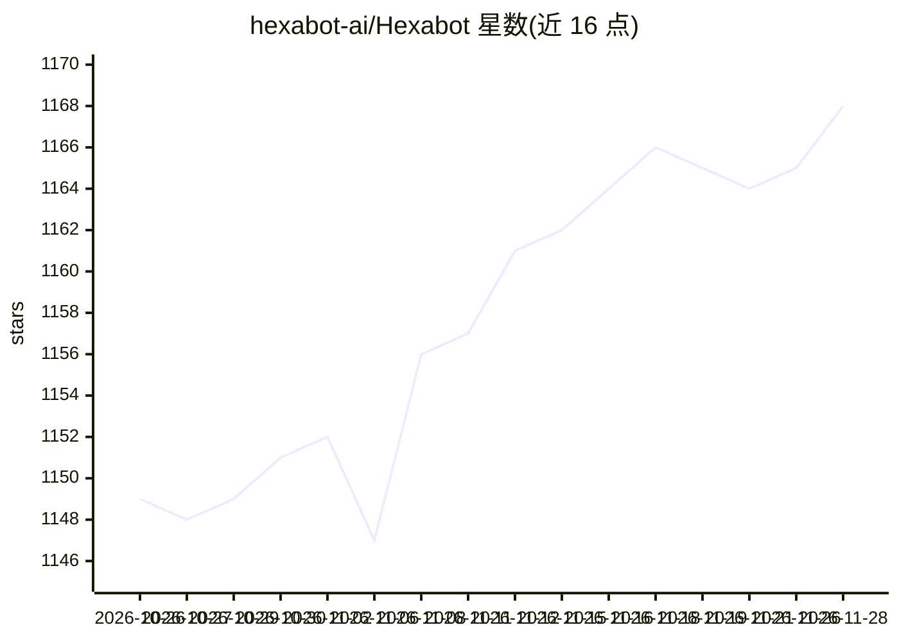

# hexabot-ai/Hexabot

⭐ 1,168 · TypeScript · NOASSERTION · 推送 2026-11-18 · [GitHub](https://github.com/hexabot-ai/Hexabot) · [官网](https://docs.hexabot.ai) · 组织维护

**给开发者的 AI 工作流自动化平台：YAML 构建跨渠道 agentic 工作流**

Hexabot v3 是一个具备 AI 能力的自动化平台，将工作流、动作、agent 与对话渠道整合在统一运行时中。工作流以 YAML 定义并带类型化运行时契约，动作通过 schema 校验输入/输出/设置，提供绑定系统、显式内存定义、MCP 集成与 RAG 支持。分发形式为 CLI：`hexabot create` 生成项目并可交互式设置管理员凭据，支持 `--docker` 运行服务，默认本地提供 Admin UI、API 与 API docs 端点。数据层默认 SQLite，生产环境一等支持 Postgres，经 `DB_TYPE` 配置。`hexabot create` 需要 TTY，CI 环境需先在本地终端执行。

## 筛选速览

| 维度 | 判定 | 备注 |
|---|---|---|
| AI 角色 | `ai-ecosystem` | LLM/agent 周边工具 |
| 许可风险 | `none` | NOASSERTION |
| 部署形态 | `library` | 以包/库形式分发 |
| 模型依赖 | — | README 未给出锁定关系 |
| 硬件要求 | — | 无带数字的原话,不猜 |
| 安装摩擦 | `low` | 无编译、无系统依赖或容器化 |
| 成熟度 | — | 结构信号不足 |

## 能力要点

- YAML 工作流定义与类型化运行时契约
- MCP 集成点支持工具/上下文互操作
- 多渠道连续性、显式内存定义与运行时内存集成
- CLI 支持 create/dev/start/stop/migrate 等命令，可搭配 Docker

## 适用场景

- 用 YAML 编排跨多个对话渠道的 agentic 工作流
- 为对话应用接入 MCP 工具与 RAG 能力
- 本地快速搭建带 Admin UI 与 API 的自动化项目

## 场景标签

`工作流自动化` `聊天机器人` `RAG` · 领域:效率与自动化

## 证据(README 行号)

> L10:  Build and run agentic workflows across channels with YAML, tools, MCP, memory and RAG.
> L20: Hexabot v3 is an automation platform with first-class AI capabilities, combining workflows, actions, and conversati
> L90: - **Agentic workflows:** YAML workflow definitions with typed runtime contracts.

## 星数曲线

2026-10-26 1,149 → 2026-11-28 1,168（+19）

---
*卡片 v1 · prompt 1.4 · 生成 2026-11-23 · 置信度 high · 依据 README sha `4ab42286f0a8` · [字段定义](../../DATASET.md)*
