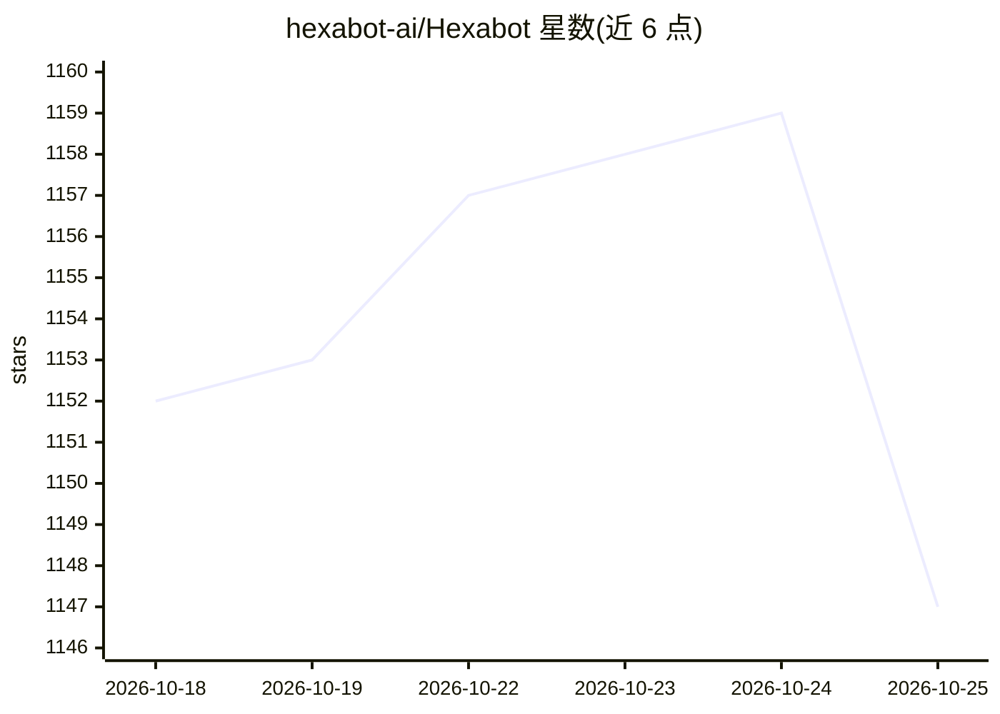

# hexabot-ai/Hexabot

⭐ 1,149 · TypeScript · NOASSERTION · 推送 2026-09-23 · [GitHub](https://github.com/hexabot-ai/Hexabot) · [官网](https://docs.hexabot.ai) · 组织维护

**给开发者的 AI 工作流自动化平台：跨渠道构建与运行 agent 工作流**

Hexabot v3 是将工作流、动作、agent 与会话渠道合并于同一运行时的自动化平台。开发者用 YAML 定义 agentic 工作流，动作以 schema 校验的输入/输出/设置定义行为，另有绑定系统、显式内存定义、MCP 集成点与多渠道支持，并广泛使用 Zod 做校验。数据层采用 TypeORM，本地默认 SQLite，生产支持 Postgres。通过 npm 安装的 CLI 创建并运行项目（hexabot create/dev），可选 Docker 服务，需 Node.js ^24.17.0；hexabot create 需交互式终端以设置管理员凭据。

## 筛选速览

| 维度 | 判定 | 备注 |
|---|---|---|
| AI 角色 | `ai-ecosystem` | LLM/agent 周边工具 |
| 许可风险 | `none` | NOASSERTION |
| 部署形态 | `library` | 以包/库形式分发 |
| 模型依赖 | — | README 未给出锁定关系 |
| 硬件要求 | — | 无带数字的原话,不猜 |
| 安装摩擦 | `low` | 无编译、无系统依赖或容器化 |
| 成熟度 | — | 结构信号不足 |

## 能力要点

- YAML 定义 agentic 工作流，带类型化运行时契约
- 支持 MCP 集成点、显式内存定义与 RAG/工具（L10）
- 多渠道会话支持与绑定系统复用能力配置
- CLI 生成项目并运行，本地默认 SQLite、生产支持 Postgres

## 适用场景

- 跨消息渠道构建并运行对话式 agent 工作流
- 用 YAML 与动作系统编排自动化任务
- 接入 MCP 工具与内存构建带上下文的 agent

## 场景标签

`工作流自动化` `Agent 框架` · 领域:Agent 开发

## 证据(README 行号)

> L20: Hexabot v3 is an automation platform with first-class AI capabilities, combining workflows, actions, and conversati
> L90: - **Agentic workflows:** YAML workflow definitions with typed runtime contracts.
> L94: - **MCP integration points:** Model Context Protocol support for tool/context interoperability.

## 星数曲线

2026-10-18 1,152 → 2026-10-25 1,147（-5）

---
*卡片 v1 · prompt 1.4 · 生成 2026-10-21 · 置信度 high · 依据 README sha `923628584c48` · [字段定义](../../DATASET.md)*
