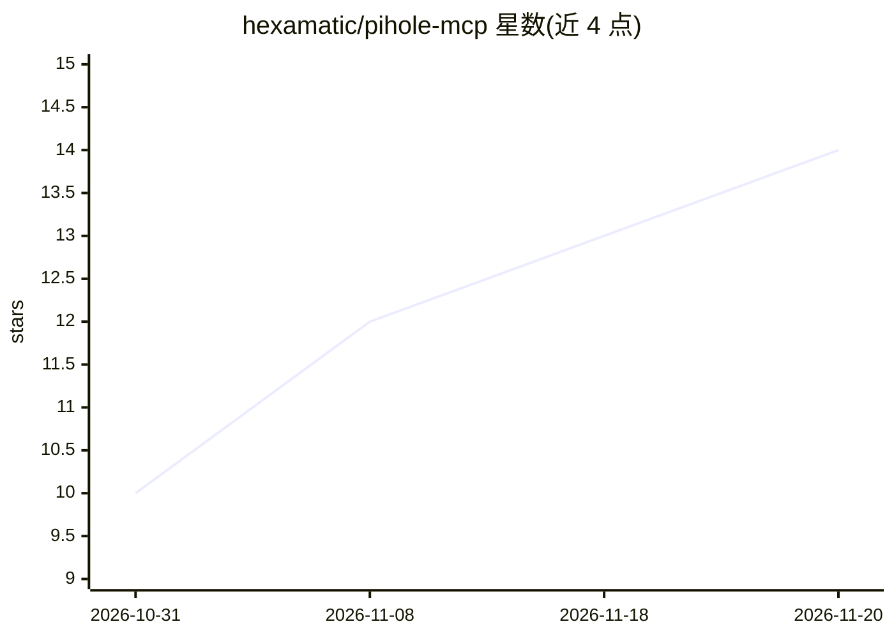

# hexamatic/pihole-mcp

⭐ 14 · Go · MIT · 推送 2026-11-16 · [GitHub](https://github.com/hexamatic/pihole-mcp) · 个人维护

**让 AI 助手通过 MCP 管理 Pi-hole v6 DNS 的 Go 服务器**

用 Go 编写的单一二进制 MCP 服务器，为 AI 助手提供对 Pi-hole v6 实例的操作通道：覆盖约 95% 的 Pi-hole v6 REST API，含 82 个工具、9 个 prompt、5 个 resource，涉及 DNS 拦截、域名与列表管理、查询分析、DHCP、网络设备与系统管理。支持只读模式（PIHOLE_READ_ONLY）与工具集裁剪（PIHOLE_TOOLSETS）控制暴露面，支持多实例配置、实例间 diff 与带 dry-run/confirm token 的同步。提供 Homebrew、Scoop、go install、Docker、deb/rpm 包与二进制下载多种安装途径。

## 筛选速览

| 维度 | 判定 | 备注 |
|---|---|---|
| AI 角色 | `ai-ecosystem` | LLM/agent 周边工具 |
| 许可风险 | `permissive` | MIT |
| 部署形态 | `desktop` | 安装包/桌面程序 |
| 模型依赖 | — | README 未给出锁定关系 |
| 硬件要求 | — | 无带数字的原话,不猜 |
| 安装摩擦 | `low` | 无编译、无系统依赖或容器化 |
| 成熟度 | — | 结构信号不足 |

## 能力要点

- 82 个工具（配置第二实例后 84 个），覆盖约 95% 的 Pi-hole v6 REST API
- PIHOLE_READ_ONLY 只读模式在每次调用时强制执行，PIHOLE_TOOLSETS 进一步收窄工具面
- 多实例 diff 与同步：dry-run 计划 + confirm token 确认后才写入
- 发布件带 cosign 签名、SPDX SBOM 与 SLSA 构建证明，收录于官方 MCP Registry

## 适用场景

- 用自然语言让 AI 助手暂停/恢复 DNS 拦截、排查域名被拦截原因
- 让 AI 助手梳理未更新的 blocklist 并做拦截统计复核
- 对比并同步家里两台 Pi-hole 的配置
- 在改动前让 AI 助手导出 teleporter 备份

## 场景标签

 · 领域:网络工具/MCP 生态

## 证据(README 行号)

> L5: A production-grade MCP server for Pi-hole v6.
> L15: Gives AI assistants full control over your Pi-hole instance: DNS blocking, domain management, query analysis, stati
> L20: - **82 tools** (84 once a second Pi-hole is configured) covering roughly 95% of the Pi-hole v6 REST API, including 

## 星数曲线

2026-10-31 10 → 2026-11-20 14（+4）

---
*卡片 v1 · prompt 1.4 · 生成 2026-11-18 · 置信度 high · 依据 README sha `b6fa59c7ce83` · [字段定义](../../DATASET.md)*
