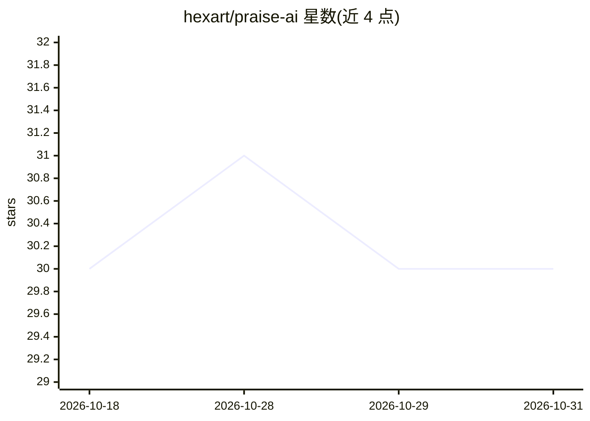

# hexart/praise-ai

⭐ 30 · TypeScript · 推送 2026-04-15 · [GitHub](https://github.com/hexart/praise-ai) · [官网](https://hexart.github.io/praise-ai/) · 个人维护 · 中文 README

**情感陪伴 AI 聊天应用：多模式对话与情感分析**

基于 React 19 + TypeScript（Vite、Tailwind）的智能情感陪伴聊天应用，后端为 FastAPI 代理服务。核心功能：基于 LLM 分析用户情感状态（类型、强度、需求），提供智能/夸夸/安慰三种聊天模式，支持流式响应、响应多样性、智能引用与情感趋势追踪。可接入本地 Ollama、OpenAI 兼容 API 与 Anthropic Claude，聊天记录仅存浏览器本地。提供 GitHub Pages 在线版、本地部署与 Docker（仅前端）部署方式。

## 筛选速览

| 维度 | 判定 | 备注 |
|---|---|---|
| AI 角色 | `ai-native` | 本体是模型或模型工具 |
| 许可风险 | `none` | — |
| 部署形态 | `self-host` | docker 或自建部署 |
| 模型依赖 | local-ok | 支持本地模型 |
| 硬件要求 | — | 无带数字的原话,不猜 |
| 安装摩擦 | `low` | 无编译、无系统依赖或容器化 |
| 成熟度 | `idea` | |

## 能力要点

- 基于 LLM 的情感分析（类型/强度/需求）驱动个性化回应
- 智能/夸夸/安慰三种聊天模式，可动态切换 Provider
- 支持本地 Ollama、OpenAI 兼容 API、Anthropic Claude
- 流式响应、响应多样性、情感趋势追踪与调试模式

## 适用场景

- 需要情感支持或鼓励时与 AI 对话陪伴
- 用本地 Ollama 模型实现隐私保护的情感聊天
- 查看情感变化趋势并导出个人数据

## 场景标签

`聊天机器人` · 领域:对话与助手

## 证据(README 行号)

> L10: - **智能情感分析**：基于 LLM 分析用户输入的情感状态、强度和需求
> L11: - **三种聊天模式**：
> L17: - **本地 Ollama**：支持本地部署的开源模型（通过 OpenAI 兼容接口）

## 星数曲线

2026-10-18 30 → 2026-10-31 30（+0）

---
*卡片 v1 · prompt 1.4 · 生成 2026-10-26 · 置信度 high · 依据 README sha `a99e4c8dc722` · [字段定义](../../DATASET.md)*
