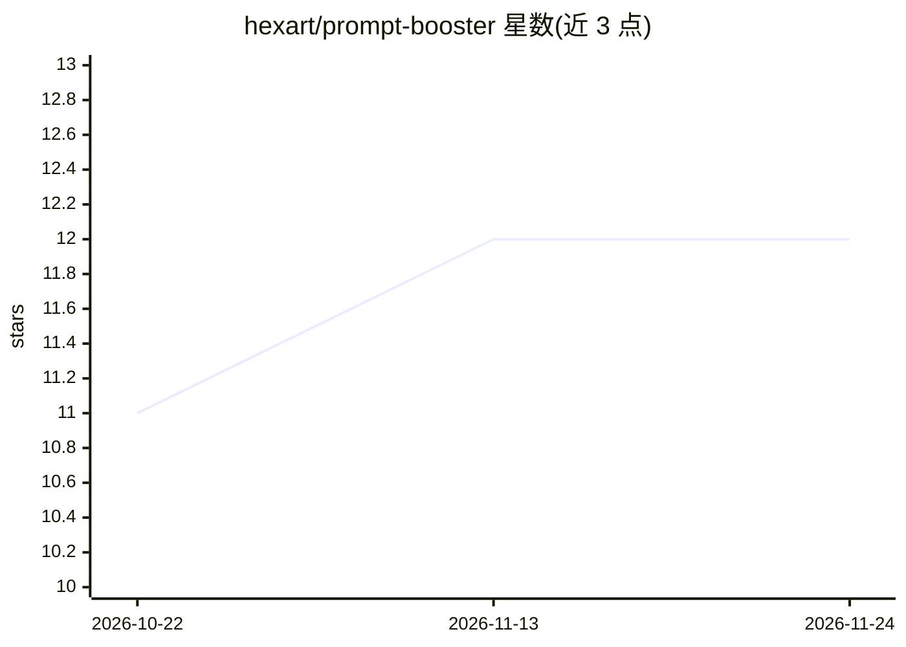

# hexart/prompt-booster

⭐ 12 · TypeScript · 推送 2026-08-04 · [GitHub](https://github.com/hexart/prompt-booster) · [官网](https://hexart.github.io/prompt-booster/) · 个人维护 · 中文 README

**面向 LLM 用户的提示词优化工具：版本控制、A/B 测试与模板管理**

一个 monorepo 项目（Turborepo + PNPM），用于优化大语言模型提示词，提供提示词增强与迭代、质量分析、A/B 测试、版本历史管理与模板系统。包含 Web 应用（含核心业务逻辑）与 Electron 桌面应用（Windows/macOS/Linux，桌面包独立用 npm 管理）；@prompt-booster/api 提供多 LLM 提供商的统一接口、流式响应与错误处理。部署支持 Docker、Docker Compose 与静态托管，需 Node.js 18.17+ 与 PNPM 10.9+。项目分 7 个阶段开发，前两阶段完成，第三阶段进行中。

## 筛选速览

| 维度 | 判定 | 备注 |
|---|---|---|
| AI 角色 | `ai-native` | 本体是模型或模型工具 |
| 许可风险 | `permissive` | — |
| 部署形态 | `self-host` | docker 或自建部署 |
| 模型依赖 | local-ok | 支持本地模型 |
| 硬件要求 | — | 无带数字的原话,不猜 |
| 安装摩擦 | `low` | 无编译、无系统依赖或容器化 |
| 成熟度 | `idea` | |

## 能力要点

- 提示词优化含版本控制、A/B 测试与模板管理
- @prompt-booster/api 统一接口支持 OpenAI、Gemini、DeepSeek、Hunyuan、Siliconflow、Ollama
- Electron 桌面应用覆盖 Windows/macOS/Linux，支持离线功能
- 提供 Docker / Docker Compose / 静态部署三种 Web 部署方式

## 适用场景

- 为不同 AI 提供商管理和迭代我的提示词版本
- 对提示词做 A/B 测试比较效果
- 在桌面端离线使用提示词优化工具
- 通过 Docker 自托管 Web 版提示词工作台

## 场景标签

`提示工程` · 领域:Agent 开发

## 证据(README 行号)

> L20: Prompt Booster is a specialized tool designed to help users optimize prompts for large language models. It leverage
> L54: - Support for OpenAI, Gemini, DeepSeek, Hunyuan, Siliconflow, and Ollama
> L67: - Prompt enhancement and iteration

## 星数曲线

2026-10-22 11 → 2026-11-24 12（+1）

---
*卡片 v1 · prompt 1.4 · 生成 2026-11-18 · 置信度 high · 依据 README sha `6cd03cf5d059` · [字段定义](../../DATASET.md)*
