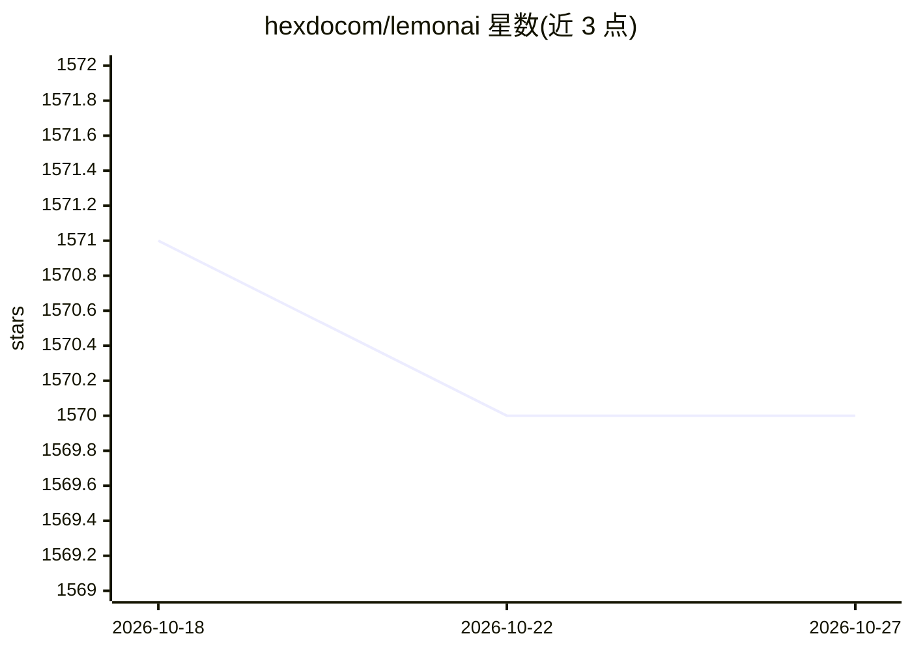

# hexdocom/lemonai

⭐ 1,570 · JavaScript · NOASSERTION · 推送 2026-02-03 · [GitHub](https://github.com/hexdocom/lemonai) · [官网](https://lemonai.cc) · 组织维护 · 中文 README

**本地全栈通用 AI Agent，可替代 Manus/Genspark 类平台**

Lemon AI 是开源全栈通用 AI Agent 平台，面向需要在本地硬件运行 agent 的用户，提供深度研究、网页浏览、代码生成与数据分析能力，支持规划、行动、反思与记忆机制。通过 Ollama、vLLM 接入 DeepSeek、Kimi、Qwen、Llama 等本地 LLM，也可配置 Claude、GPT、Gemini、Grok 等云端 API 增强结果。代码执行在 Docker VM 沙箱内运行以保护本机文件与系统；附带 Lemon AI Editor，可点击 HTML 元素由 AI 修改生成结果。以 Docker 部署为主，许可为 Apache 2.0 附加限制的 Lemon AI 开源许可，另提供商业许可咨询。

## 筛选速览

| 维度 | 判定 | 备注 |
|---|---|---|
| AI 角色 | `ai-native` | 本体是模型或模型工具 |
| 许可风险 | `none` | NOASSERTION |
| 部署形态 | `self-host` | docker 或自建部署 |
| 模型依赖 | local-ok | 支持本地模型 |
| 硬件要求 | — | 无带数字的原话,不猜 |
| 安装摩擦 | `low` | 无编译、无系统依赖或容器化 |
| 成熟度 | — | 结构信号不足 |

## 能力要点

- 深度研究、浏览、vibe coding、数据分析等通用 Agent 任务
- 经 Ollama/vLLM 使用本地 LLM，支持云端 API 作为增强选项
- Docker VM 沙箱执行代码以隔离保护本机
- Lemon AI Editor：点击 HTML 元素由 AI 局部修改生成结果

## 适用场景

- 在本地跑一个能做研究、写代码、分析数据的通用 Agent
- 不依赖云端、保护隐私地完成 Agent 任务
- 对 AI 生成的 HTML 页面做局部反复编辑调整

## 场景标签

`AI 助手` `编码 Agent` `数据分析` · 领域:效率与自动化

## 证据(README 行号)

> L14: **​Lemon AI empowers deep research, web browsing, vibe coding, and data analysis – running entirely on your local h
> L16: For enhanced security, Lemon AI operates within a ​**local Virtual Machine (VM) sandbox by Docker.** This sandbox *

## 星数曲线

2026-10-18 1,571 → 2026-10-27 1,570（-1）

---
*卡片 v1 · prompt 1.4 · 生成 2026-10-21 · 置信度 high · 依据 README sha `ad9207c5689d` · [字段定义](../../DATASET.md)*
