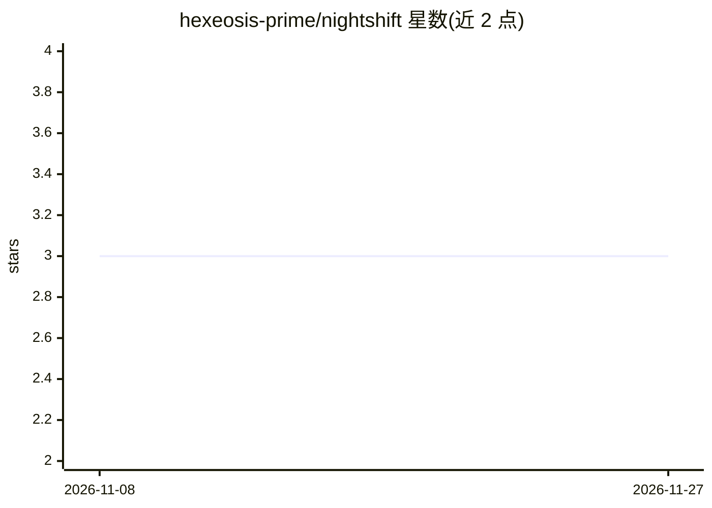

# hexeosis-prime/nightshift

⭐ 3 · Python · Apache-2.0 · 推送 2026-11-22 · [GitHub](https://github.com/hexeosis-prime/nightshift) · 个人维护

**本地 ComfyUI 音乐视频生成流水线，可由 agent 经 MCP 驱动**

在本地 ComfyUI 上以开放权重模型把歌曲创意转成完整音乐视频：MiniMax Music 3 依歌词简报生成并演唱歌曲，FLUX 3 Klein 生成三联角色定妆图并保持跨镜头一致性，LTX 2.3 做对口型与镜头动画，Python 工具负责卡点剪辑、调色与歌词 HUD 叠加。提供浏览器 Studio、CLI 与 MCP server 三种入口，支持逐步检查点的 Director 模式与一次到底的 Yolo/Full Agent 模式。模型权重许可含非商业条款；需 24 GB VRAM 的 NVIDIA GPU。

## 筛选速览

| 维度 | 判定 | 备注 |
|---|---|---|
| AI 角色 | `ai-native` | 本体是模型或模型工具 |
| 许可风险 | `permissive` | Apache-2.0 |
| 部署形态 | `library` | 以包/库形式分发 |
| 模型依赖 | — | README 未给出锁定关系 |
| 硬件要求 | `gpu-24g` | |
| 安装摩擦 | `medium` | 含编译或系统依赖之一 |
| 成熟度 | — | 结构信号不足 |

## 能力要点

- MiniMax Music 3 歌曲生成 + FLUX 3 Klein 角色一致性 + LTX 2.3 视频动画的完整流水线
- MCP server 将全流程暴露为工具，可接 Claude 或任意 MCP agent
- Director 模式在角色定妆、歌曲、首帧、take、成片五个检查点停下供人工审阅
- 逐步幂等渲染：只补渲染缺失或被修改的镜头

## 适用场景

- 为自己的歌曲在本地 GPU 上批量生成带对口型的音乐视频
- 让 agent 通过 MCP 全自动跑完整条制作流水线
- 按镜头审阅并只重渲染需修改的部分以迭代成片

## 场景标签

`图像生成` `视频生成` `语音合成` · 领域:内容生成

## 证据(README 行号)

> L6: Nightshift turns a song idea into a finished music video with open-weight models running in a local
> L17: **Nightshift Studio** (`nightshift app`) puts all of it behind one page in your browser: a photo, a song, a scene, 
> L86: |GPU|NVIDIA with 24 GB VRAM. Built and tested on an RTX 3090. LTX 2.3 (22B, quantized) uses most of it, so nothing 

## 星数曲线

2026-11-08 3 → 2026-11-27 3（+0）

---
*卡片 v1 · prompt 1.4 · 生成 2026-11-26 · 置信度 high · 依据 README sha `26d622696aad` · [字段定义](../../DATASET.md)*
