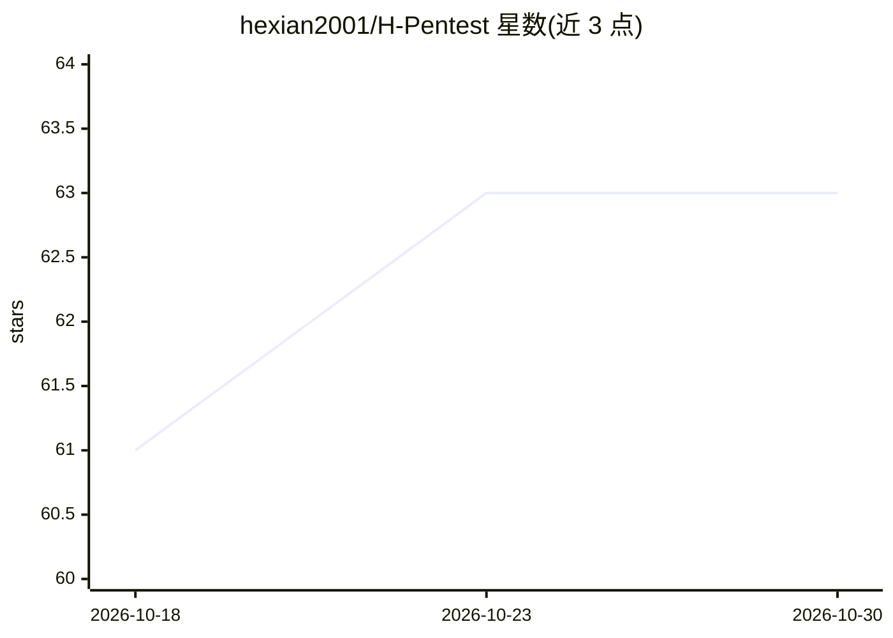

# hexian2001/H-Pentest

⭐ 63 · Python · 推送 2025-12-11 · [GitHub](https://github.com/hexian2001/H-Pentest) · 个人维护 · 中文 README

**LLM 多 Agent 协作的全自动渗透测试平台，面向安全研究人员**

基于大语言模型的全自动渗透测试平台，采用多 Agent 协作架构：Meta Supervisor 元监督层、Strategic Supervisor 战略规划层、Worker Agent 执行层（GLM-4.6，ReAct 框架）、Payload Master 载荷生成与 Report Supervisor 报告生成。集成 52+ 攻击知识库（基于 105 个真实案例）、Docker 沙箱隔离执行、Kali 工具容器与 nuclei 漏洞扫描，提供 Vue 3 实时可视化界面。支持 CTF 激进模式与 RealWorld 稳健模式，需 OpenAI API 兼容 LLM 且 Docker 为必需依赖，仅限合法授权测试。

## 筛选速览

| 维度 | 判定 | 备注 |
|---|---|---|
| AI 角色 | `ai-native` | 本体是模型或模型工具 |
| 许可风险 | `none` | — |
| 部署形态 | `self-host` | docker 或自建部署 |
| 模型依赖 | — | README 未给出锁定关系 |
| 硬件要求 | — | 无带数字的原话,不猜 |
| 安装摩擦 | `low` | 无编译、无系统依赖或容器化 |
| 成熟度 | — | 结构信号不足 |

## 能力要点

- 多 Agent 五层协作架构（元监督/战略规划/执行/载荷/报告）
- 52+ 攻击知识库，来自 105 个真实案例，支持 RAG 检索
- Docker 沙箱隔离执行 AI 生成代码（非 root、512MB 内存限制、用后销毁）
- 集成 nuclei（11,000+ CVE 模板）、目录扫描、Kali 工具容器等工具

## 适用场景

- 在授权环境下自动化执行渗透测试并生成漏洞报告
- CTF 比赛中自动寻找并提交 FLAG
- 安全研究人员通过 Web 界面监控多 Agent 测试过程并人工干预

## 场景标签

`多智能体` `网络安全` · 领域:Agent 开发

## 证据(README 行号)

> L17: H-Pentest 是一个基于大语言模型(LLM)驱动的**全自动化渗透测试平台**，采用**多Agent协作架构**，集成了52+攻击知识库、Docker沙箱环境和实时可视化界面，为安全研究人员提供企业级的渗透测试自动化解决方案
> L46:  - GLM-4.6模型，快速响应
> L95: |**execute_python**|Python沙箱|Docker容器隔离执行，512MB内存，预装渗透库|

## 星数曲线

2026-10-18 61 → 2026-10-30 63（+2）

---
*卡片 v1 · prompt 1.4 · 生成 2026-10-24 · 置信度 high · 依据 README sha `38256936c6c7` · [字段定义](../../DATASET.md)*
