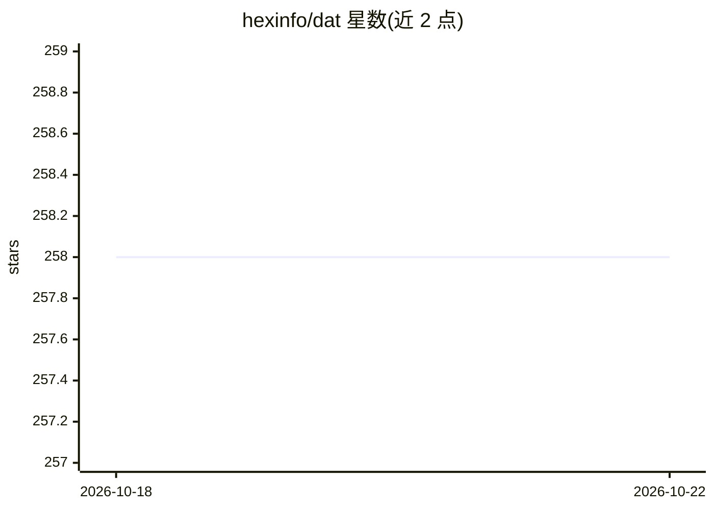

# hexinfo/dat

⭐ 258 · Java · Apache-2.0 · 推送 2025-12-26 · [GitHub](https://github.com/hexinfo/dat) · [官网](https://deepwiki.com/hexinfo/dat) · 组织维护 · 中文 README

**面向企业智能问数的语义建模框架：自然语言查数据库**

Java 编写的智能问数（ChatBI/NL2SQL）框架，而非平台：通过 YAML 定义数据模型与语义模型（实体/维度/度量），Askdata Agent 工作流基于 LLM 生成语义 SQL 并转为真实 SQL 执行，支持 MySQL/PostgreSQL/Oracle/DuckDB，向量化存储 SQL 问答对与业务知识（DuckDB/Weaviate/PGVector）。以 CLI（init/run/seed/server）供本地开发调试，可通过 dat-sdk 二次开发 Web UI，或以 OpenAPI/MCP 服务对外提供；另有 Dify 插件对接 WEB 问答。要求 Java 17+ 与至少一个 LLM API。

## 筛选速览

| 维度 | 判定 | 备注 |
|---|---|---|
| AI 角色 | `ai-ecosystem` | LLM/agent 周边工具 |
| 许可风险 | `permissive` | Apache-2.0 |
| 部署形态 | `None` |  |
| 模型依赖 | — | README 未给出锁定关系 |
| 硬件要求 | — | 无带数字的原话,不猜 |
| 安装摩擦 | `medium` | 含编译或系统依赖之一 |
| 成熟度 | — | 结构信号不足 |

## 能力要点

- YAML 预建模数据模型与语义模型（实体/维度/度量）
- 可插拔 SPI 架构，支持多种数据库、LLM 与嵌入模型
- 可对外提供 OpenAPI 与 MCP 服务，支持 MCP 类 Agent 集成
- dat-sdk 支持 Java 应用内二次开发；CLI 支持 seed 加载 CSV 种子数据

## 适用场景

- 让业务人员用自然语言查询企业数据库，无需写 SQL
- 在 Dify 或自有 Web 项目中集成流式智能问数
- 通过 MCP 将问数能力接入 Claude Desktop、Cline 等 Agent

## 场景标签

`数据分析` · 领域:效率与自动化

## 证据(README 行号)

> L70: - 2、DAT 它不是一个 platform ，而是一个 `framework`；二次开发者可以基于 `dat-sdk` 开发自己的Web UI，可以是web ide、拖拉拽的workflow、列表等交互方式；或将其对外提供 `O
> L336: DAT提供了 `dat-sdk` 开发工具包，方便开发者在自己的Java应用中集成DAT的智能问数能力。您可以基于SDK开发自定义的Web UI、API服务或集成到现有系统中。

## 星数曲线

2026-10-18 258 → 2026-10-22 258（+0）

---
*卡片 v1 · prompt 1.4 · 生成 2026-10-22 · 置信度 high · 依据 README sha `2990fd30259d` · [字段定义](../../DATASET.md)*
