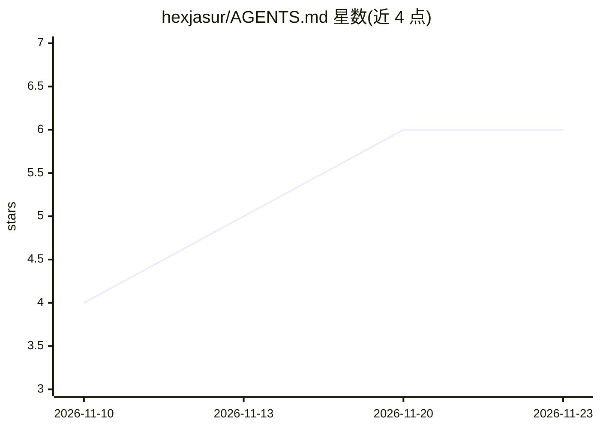

# hexjasur/AGENTS.md

⭐ 6 · JavaScript · MIT · 推送 2026-11-18 · [GitHub](https://github.com/hexjasur/AGENTS.md) · 个人维护

**为开发者向 AI 编码代理一键安装项目规则与技能包**

npm CLI 工具，将 AGENTS.md 项目级约定与 17 个 Agent Skills（覆盖 React/TypeScript、Web 性能/无障碍/安全、Tauri、GitHub Actions、Ren'Py 等）写入任意仓库；安装前确认、不隐式覆盖已有文件，用 SHA-256 清单支持安全更新；附带技能 lint 器与基于 OpenAI 兼容 API 的评测运行器。面向使用 AI 编码代理的前端、Tauri 与视觉小说开发者。

## 筛选速览

| 维度 | 判定 | 备注 |
|---|---|---|
| AI 角色 | `ai-ecosystem` | LLM/agent 周边工具 |
| 许可风险 | `permissive` | MIT |
| 部署形态 | `desktop` | 安装包/桌面程序 |
| 模型依赖 | — | README 未给出锁定关系 |
| 硬件要求 | — | 无带数字的原话,不猜 |
| 安装摩擦 | `low` | 无编译、无系统依赖或容器化 |
| 成熟度 | — | 结构信号不足 |

## 能力要点

- npx 一条命令交互式安装 AGENTS.md 与 17 个技能
- SHA-256 清单校验，本地改动后 update 默认停止
- 技能 lint 器与 GitHub Action，检查元数据/链接/凭据格式
- 评测运行器对比有无技能的响应断言通过率

## 适用场景

- 让 AI 代理不再重复解释项目技术栈约定
- 为 React/Tauri/Ren'Py 项目装一套领域最佳实践
- CI 中 lint 团队自写的 Agent Skills

## 场景标签

 · 领域:开发者工具/AI 编码辅助

## 证据(README 行号)

> L3:  Stop re-explaining your stack to your AI. Install it once.
> L30: Works with any agent client that reads `AGENTS.md` and Agent Skills. Existing files are never overwritten without a
> L147: This keeps prompts small, makes guidance reusable across projects, and follows the Agent Skills specification and 

## 星数曲线

2026-11-10 4 → 2026-11-23 6（+2）

---
*卡片 v1 · prompt 1.4 · 生成 2026-11-21 · 置信度 high · 依据 README sha `2969249ac6fa` · [字段定义](../../DATASET.md)*
