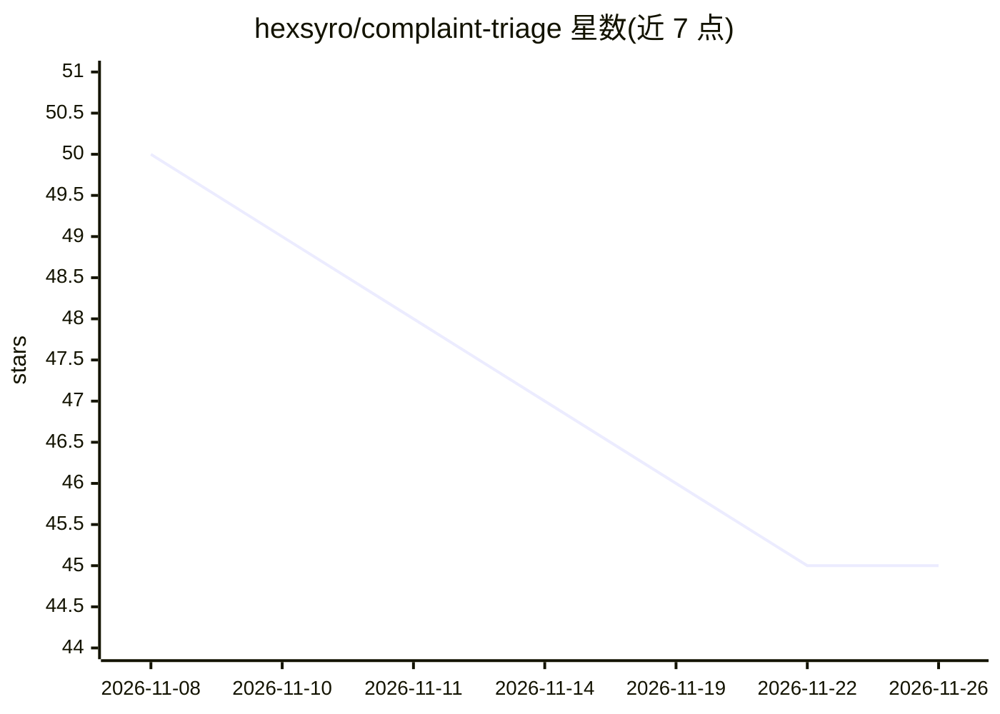

# hexsyro/complaint-triage

⭐ 45 · Jupyter Notebook · 推送 2026-10-30 · [GitHub](https://github.com/hexsyro/complaint-triage) · 个人维护

**多类文本分类器：把消费者投诉路由到对应产品类别**

基于公开消费者投诉数据集（5 万条、10 个产品类别）构建的多类文本分类项目：用 TF-IDF 向量化投诉的 Issue 字段，比较 MultinomialNB、LogisticRegression 与 LinearSVC，最终模型为包裹 CalibratedClassifierCV 的 LinearSVC，输出类别与校准概率。提供按步骤运行的数据加载、预处理、训练、评估脚本及 CLI 路由器 route_complaint(text)，可交互输入投诉并返回预测类别与置信度。README 明确指出 Issue 字段取值有限导致高分偏乐观，对新措辞文本置信度会下降。

## 筛选速览

| 维度 | 判定 | 备注 |
|---|---|---|
| AI 角色 | `ai-native` | 本体是模型或模型工具 |
| 许可风险 | `none` | — |
| 部署形态 | `library` | 以包/库形式分发 |
| 模型依赖 | — | README 未给出锁定关系 |
| 硬件要求 | — | 无带数字的原话,不猜 |
| 安装摩擦 | `low` | 无编译、无系统依赖或容器化 |
| 成熟度 | — | 结构信号不足 |

## 能力要点

- 三种分类器在 5 万条/10 类投诉上的对比评估（macro-F1 约 0.979）
- LinearSVC 包裹 CalibratedClassifierCV 输出校准概率
- 交互式 CLI 路由器 route_complaint(text) 实时预测类别与置信度
- 含 5 个 Kaggle notebook 与混淆矩阵分析

## 适用场景

- 把客户投诉自动分派到对应处理部门/产品类别
- 学习 TF-IDF 向量化与多类文本分类的完整流程
- 试验不同投诉措辞下模型的预测与置信度表现

## 场景标签

`教程课程` · 领域:学习与行业

## 证据(README 行号)

> L5: This project uses a public consumer complaints dataset (real-world text complaints tagged with a product/department 
> L20: **Setup:** 10 product categories, a balanced sample of 50,000 complaints (5,000 per category), stratified 80/20 spl
> L97:    python -m src.route

## 星数曲线

2026-11-08 50 → 2026-11-26 45（-5）

---
*卡片 v1 · prompt 1.4 · 生成 2026-11-18 · 置信度 mid · 依据 README sha `78dc44511a02` · [字段定义](../../DATASET.md)*
