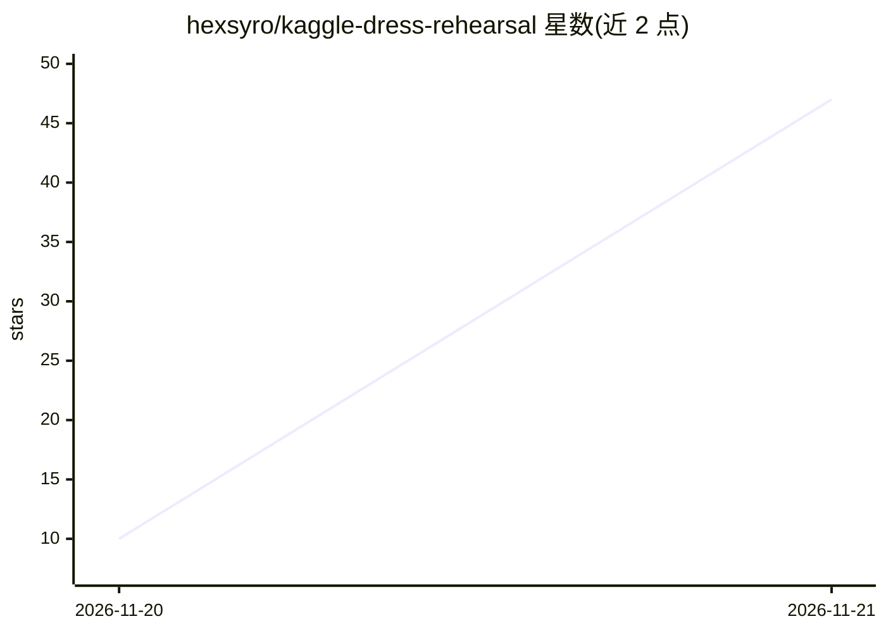

# hexsyro/kaggle-dress-rehearsal

⭐ 47 · HTML · MIT · 推送 2026-11-19 · [GitHub](https://github.com/hexsyro/kaggle-dress-rehearsal) · 个人维护

**Kaggle 验证纪律教学项目：分层CV、三种调参对比与榜上过拟合模拟**

一个模型选择流程的教学实验仓库：在 Telco 客户流失数据集（7,043 条）上运行 KFold 与 StratifiedKFold 对比、GridSearchCV/RandomizedSearchCV/Optuna 三种搜索策略计时对比，以及模拟 public/private leaderboard 划分的榜上过拟合实验。README 记录了本次运行的具体数值结论，并以脚本（src/）与 5 个 Kaggle notebook 两种形式提供，另列出扩展实验方向。项目目的在于练习验证与调参技能，而非交付可复用的软件包。

## 筛选速览

| 维度 | 判定 | 备注 |
|---|---|---|
| AI 角色 | `ai-knowledge` | 知识聚合/清单类 |
| 许可风险 | `permissive` | MIT |
| 部署形态 | `library` | 以包/库形式分发 |
| 模型依赖 | — | README 未给出锁定关系 |
| 硬件要求 | — | 无带数字的原话,不猜 |
| 安装摩擦 | `low` | 无编译、无系统依赖或容器化 |
| 成熟度 | — | 结构信号不足 |

## 能力要点

- KFold vs StratifiedKFold 折间稳定性对比（ churn 占比标准差 0.0072 vs 0.0002）
- GridSearchCV、RandomizedSearchCV、Optuna 三策略同空间对比并计时
- public/private leaderboard 划分模拟，10-50 次调参试验的 AUC 跟踪
- src/ 脚本与 5 个可在 Kaggle 打开的 notebook 双形式提供

## 适用场景

- 练习交叉验证与分层抽样的正确用法
- 比较不同超参数搜索策略的得分与耗时
- 模拟 Kaggle 榜上过拟合现象并学习规避方法

## 场景标签

`模型评测` `教程课程` · 领域:评测与运维

## 证据(README 行号)

> L5: This project runs a full, disciplined model-selection pipeline that mimics exactly what a real Kaggle competition de
> L79: |Skill|Where|

## 星数曲线

2026-11-20 10 → 2026-11-21 47（+37）

---
*卡片 v1 · prompt 1.4 · 生成 2026-11-20 · 置信度 high · 依据 README sha `451261dc309e` · [字段定义](../../DATASET.md)*
