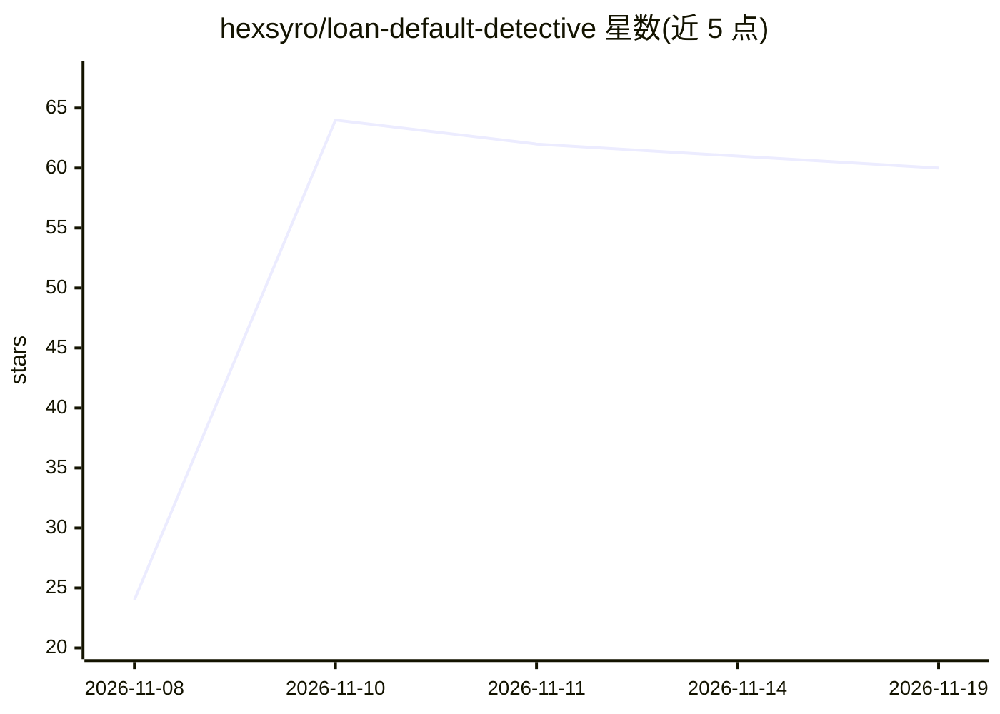

# hexsyro/loan-default-detective

⭐ 60 · Jupyter Notebook · MIT · 推送 2026-10-30 · [GitHub](https://github.com/hexsyro/loan-default-detective) · 个人维护

**用 6 种经典 ML 模型预测 135 万笔贷款违约的教学型分析项目**

基于公开 Lending Club 贷款数据（1,353,695 笔中留出测试集 203,154 笔、违约率 19.5%）的端到端机器学习项目：并行做贷款违约分类（Logistic Regression、Decision Tree、Random Forest、SVM、KNN、Naive Bayes）与利率回归（Linear Regression），在统一的 accuracy/precision/recall/F1/ROC-AUC 指标下对比。重点讨论类不平衡下 accuracy 的误导、precision/recall 权衡，以及移除贷后数据泄漏列（recoveries）前后的 AUC 差异。提供按序运行的数据加载、预处理、训练、评估脚本与 6 个 notebook，原始数据需从 Kaggle 自行下载。面向学习与实践经典监督学习方法的使用者。

## 筛选速览

| 维度 | 判定 | 备注 |
|---|---|---|
| AI 角色 | `ai-native` | 本体是模型或模型工具 |
| 许可风险 | `permissive` | MIT |
| 部署形态 | `library` | 以包/库形式分发 |
| 模型依赖 | — | README 未给出锁定关系 |
| 硬件要求 | — | 无带数字的原话,不猜 |
| 安装摩擦 | `low` | 无编译、无系统依赖或容器化 |
| 成熟度 | — | 结构信号不足 |

## 能力要点

- 6 种分类器 + 线性回归在统一指标下直接对比
- 识别并移除数据泄漏列（recoveries），AUC 从约 0.90 修正到 0.71
- 围绕类不平衡分析 accuracy 陷阱与 precision/recall 权衡
- 完整流水线：data_load → preprocess → train → evaluate，附 6 个 notebook

## 适用场景

- 我想学习如何在类不平衡数据上评估违约预测模型
- 我想参考一个包含数据清洗、特征缩放、多模型对比的完整 ML 项目结构
- 我想了解数据泄漏如何虚高模型指标并如何排查

## 场景标签

`教程课程` `金融量化` · 领域:学习与行业

## 证据(README 行号)

> L5: This project uses a public lending dataset (loan amount, interest rate, installment, debt-to-income, revolving utili
> L19: 1. **Accuracy is a trap:** predicting "no default" for every loan scores 80.5% accuracy and catches 0% of defaults.

## 星数曲线

2026-11-08 24 → 2026-11-19 60（+36）

---
*卡片 v1 · prompt 1.4 · 生成 2026-11-18 · 置信度 mid · 依据 README sha `923501823569` · [字段定义](../../DATASET.md)*
