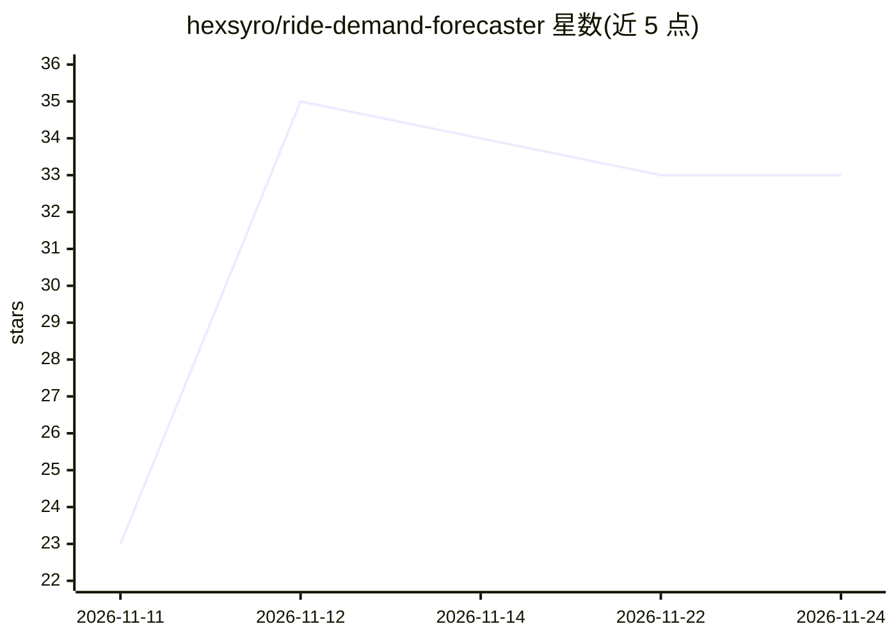

# hexsyro/ride-demand-forecaster

⭐ 33 · Jupyter Notebook · 推送 2026-11-07 · [GitHub](https://github.com/hexsyro/ride-demand-forecaster) · 个人维护

**共享单车需求预测实验项目：对比四阶段特征工程的 RMSE 变化**

以 Kaggle 共享单车数据集（时间戳、天气、温湿度、节假日等）预测每小时骑行量，核心方法是固定同一个 Random Forest 回归器（250 棵树、固定随机种子），分别训练于原始、编码、标准化与完整特征工程四版数据，逐阶段展示 RMSE 变化（952.5→250.2→250.0→221.5）。以 Python 脚本流水线与 7 个按序执行的 Jupyter notebook 形式提供，数据需自行从 Kaggle 下载。README 注明随机切分导致的最优分数偏乐观问题，并建议改用时间切分。

## 筛选速览

| 维度 | 判定 | 备注 |
|---|---|---|
| AI 角色 | `ai-native` | 本体是模型或模型工具 |
| 许可风险 | `none` | — |
| 部署形态 | `library` | 以包/库形式分发 |
| 模型依赖 | — | README 未给出锁定关系 |
| 硬件要求 | — | 无带数字的原话,不猜 |
| 安装摩擦 | `low` | 无编译、无系统依赖或容器化 |
| 成熟度 | — | 结构信号不足 |

## 能力要点

- 同一 Random Forest 在四阶段数据版本上的 RMSE 对比，固定种子可复现
- 时间戳分解为 hour/day_of_week/rush_hour/days_since_start 等特征
- 提供 02-06 号 notebook，每个引入一项特征工程技术并保存中间数据集
- README 记录了随机切分导致乐观偏差的局限与改进方向

## 适用场景

- 我想学习特征工程各阶段对回归模型误差的影响
- 我想参考一个可复现的端到端表格数据预处理流水线
- 我想了解单车需求数据在工作日/周末的时段规律

## 场景标签

`教程课程` · 领域:学习与行业

## 证据(README 行号)

> L5: This project uses a bike-share demand dataset (timestamp, weather conditions, temperature, humidity, wind speed, hol
> L19: 1. **Hour of day is the biggest lever:** test RMSE fell from 952.5 on the raw table to 250.2 on the encoded table, 

## 星数曲线

2026-11-11 23 → 2026-11-24 33（+10）

---
*卡片 v1 · prompt 1.4 · 生成 2026-11-18 · 置信度 mid · 依据 README sha `8099b0d316f4` · [字段定义](../../DATASET.md)*
