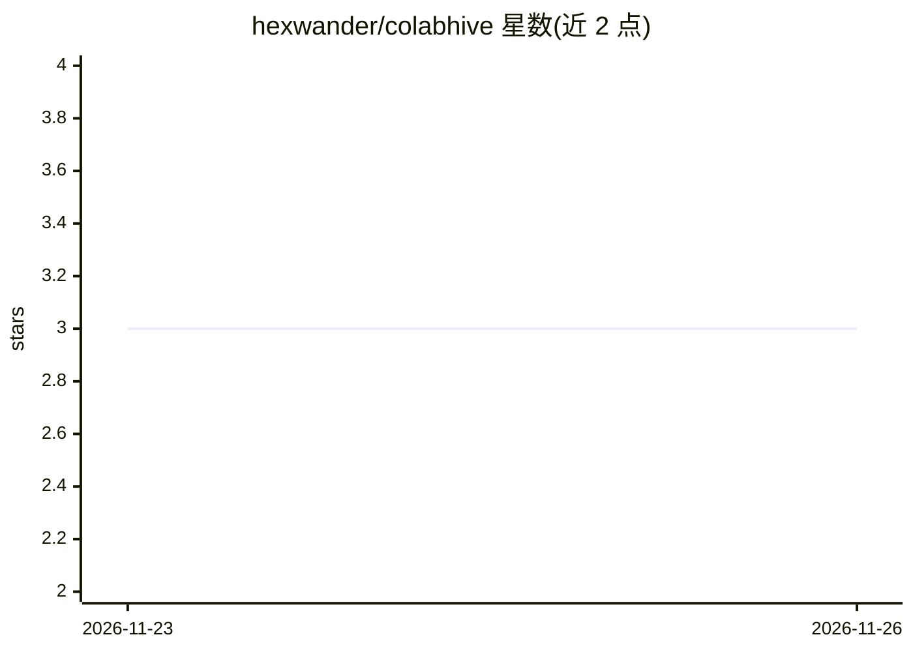

# hexwander/colabhive

⭐ 3 · Go · Apache-2.0 · 推送 2026-11-25 · [GitHub](https://github.com/hexwander/colabhive) · [官网](https://hexwander.github.io/colabhive/) · 个人维护 · 中文 README

**把多个 Google Colab 账户池化成自托管 GPU 集群与 MCP 路由器**

以 Go 编写的工具，将分散的 Google Colab 账户池化为单一自托管 GPU 集群：支持多账户配额池化、K 路并行分片执行、跨账户故障转移（H100→G4→A100→L4→T4 级联）、僵尸进程检测与 8 秒保活重连。提供无框系统托盘/菜单栏桌面应用（Windows/macOS/Linux）、无头三协议 MCP 路由器（Streamable HTTP/SSE/stdio）以及 Python SDK 和 drop-in colab CLI。面向持有多账户的 ML 工程师与研究团队，另提供 Docker 部署的多租户团队云服务器模式，贡献者门户仅申请 Colaboratory 权限范围。

## 筛选速览

| 维度 | 判定 | 备注 |
|---|---|---|
| AI 角色 | `ai-ecosystem` | LLM/agent 周边工具 |
| 许可风险 | `permissive` | Apache-2.0 |
| 部署形态 | `desktop` | 安装包/桌面程序 |
| 模型依赖 | — | README 未给出锁定关系 |
| 硬件要求 | — | 无带数字的原话,不猜 |
| 安装摩擦 | `low` | 无编译、无系统依赖或容器化 |
| 成熟度 | — | 结构信号不足 |

## 能力要点

- 多账户池化与原子槽位预留、过期批次优先调度
- 4× 并行 GPU 分片运行与 worker PID 热重启（缓存保持）
- 无头三协议 MCP 路由器，一键配置 8 个 AI 编码客户端
- EWMA 校准将 Compute Units 换算为 GPU 小时并展示配额矩阵

## 适用场景

- 把实验室多个 Colab 账户的算力合并给团队共享
- 让 Claude Code/Cursor 等编码代理无头调用池化 GPU
- 用多账户并行跑分片实验以缩短总时长
- 安全接收队友的到期 CU 捐赠而不暴露密码

## 场景标签

`推理引擎` `MLOps` · 领域:训练与推理

## 证据(README 行号)

> L5: **Turn scattered Google Colab accounts into one self-hosted GPU cluster, 4× parallel shard runner, and headless MCP 
> L89: |**MCP Agent Integration**|❌ None|⚠️ Requires Chrome tab, `1013 Server is busy` lock, `list_changed` tool-hiding bu
> L67:  <code>Agent · 8 IDEs</code> : 1-click surgical config sync for Claude Code , Codex , Antigravity , Cursor , Gemini

## 星数曲线

2026-11-23 3 → 2026-11-26 3（+0）

---
*卡片 v1 · prompt 1.4 · 生成 2026-11-23 · 置信度 high · 依据 README sha `1bdeae4b35ed` · [字段定义](../../DATASET.md)*
