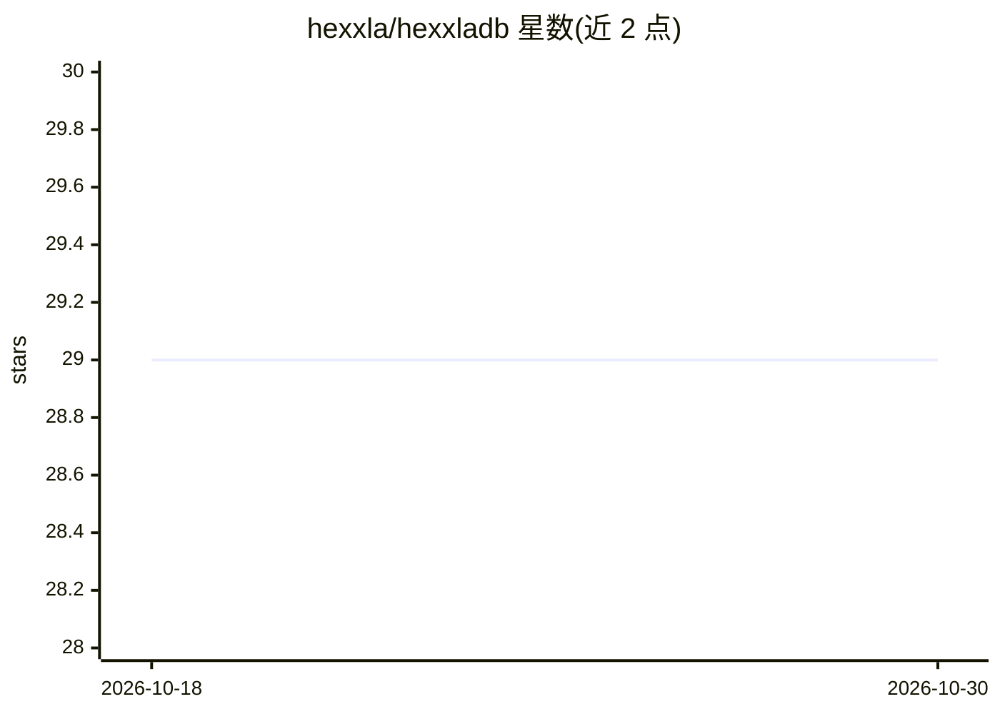

# hexxla/hexxladb

⭐ 29 · Go · MIT · 推送 2026-08-27 · [GitHub](https://github.com/hexxla/hexxladb) · [官网](https://hexxladb.mintlify.app/) · 个人维护

**面向 Go 的嵌入式六边形网格数据库，支持向量检索与矛盾追踪**

HexxlaDB 是一个用 Go 编写的嵌入式数据库库：记录存放在六边形网格坐标 (q,r) 上，检索按环向外扩展并可设定结果上限与有效期。提供 Cell/Seam/Edge/Facet/Embedding 五种原语，显式存储矛盾与替代关系（seams），支持 MVCC 时间旅行、HNSW 向量近似搜索、混合 ANN+过滤查询、Dijkstra 路径查找，以及 XChaCha20-Poly1305 认证加密与离线迁移。单个二进制、无网络调用。数据库自身不推断语义位置、不调用嵌入 provider。面向需要空间局部性、溯源与有界上下文组装的开发者（如 Agent/LLM 记忆、游戏世界状态、知识图谱）。

## 筛选速览

| 维度 | 判定 | 备注 |
|---|---|---|
| AI 角色 | `ai-ecosystem` | LLM/agent 周边工具 |
| 许可风险 | `permissive` | MIT |
| 部署形态 | `None` |  |
| 模型依赖 | — | README 未给出锁定关系 |
| 硬件要求 | — | 无带数字的原话,不猜 |
| 安装摩擦 | `low` | 无编译、无系统依赖或容器化 |
| 成熟度 | — | 结构信号不足 |

## 能力要点

- 记录位于六边形坐标，环走检索（LoadContext/FOV/Voronoi）且有界
- 矛盾与替代关系以 seams 显式存储并可检索（FindSeams）
- 本地维护并搜索 HNSW 向量索引，支持混合 ANN+过滤查询
- MVCC 时间旅行（ViewAt/SnapshotDiff）与认证加密存储（XChaCha20-Poly1305）

## 适用场景

- 为 Agent/LLM 存储对话记忆、事实与偏好，并组装有界上下文候选
- 管理带时间有效期与矛盾追踪的知识图谱
- 六边形网格游戏世界状态存储（FOV、Dijkstra 寻路、快照回滚）
- 需要溯源与置信度的空间标注层（传感器读数、事件）

## 场景标签

`向量数据库` `知识图谱` · 领域:知识与检索

## 证据(README 行号)

> L14: HexxlaDB is an embedded Go library for structured, spatially-organised records. Items live at hex grid coordinates 
> L136: - **Agent and LLM memory** — store conversation turns, facts, and preferences at hex coordinates; retrieve bounded

## 星数曲线

2026-10-18 29 → 2026-10-30 29（+0）

---
*卡片 v1 · prompt 1.4 · 生成 2026-10-26 · 置信度 high · 依据 README sha `fca987aad58c` · [字段定义](../../DATASET.md)*
