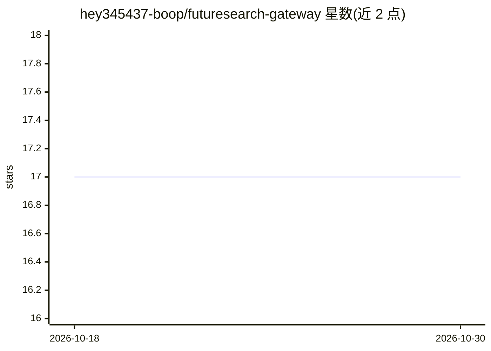

# hey345437-boop/futuresearch-gateway

⭐ 17 · Go · MIT · 推送 2026-10-07 · [GitHub](https://github.com/hey345437-boop/futuresearch-gateway) · 个人维护 · 中文 README

**把 FutureSearch 异步研究 API 反代成 OpenAI 兼容端点的 Go 网关**

用 Go 编写的单程序网关：将 FutureSearch 的“提交任务→等待→读结果”异步流程转换为 OpenAI Chat Completions 接口（支持流式，等待期以 reasoning_content 输出进度）与两组 MCP 服务（21 个研究工具 + 可选的本地文件工具）。面向希望用 DSH、OpenAI SDK、MCP 客户端统一接入 FutureSearch 的用户，内置中文管理面板，提供账号池、租户额度、冷却与前置指令功能；上游覆盖 143 个模型档位、35 个家族入口、7 个研究预设。token 用量与扣款均为估算值，仅支持纯文本输入，HTTP MCP 与预览入口默认无鉴权。

## 筛选速览

| 维度 | 判定 | 备注 |
|---|---|---|
| AI 角色 | `ai-ecosystem` | LLM/agent 周边工具 |
| 许可风险 | `permissive` | MIT |
| 部署形态 | `desktop` | 安装包/桌面程序 |
| 模型依赖 | — | README 未给出锁定关系 |
| 硬件要求 | — | 无带数字的原话,不猜 |
| 安装摩擦 | `low` | 无编译、无系统依赖或容器化 |
| 成熟度 | — | 结构信号不足 |

## 能力要点

- OpenAI 兼容 /v1/chat/completions 与 /v1/models，流式以 reasoning_content 输出任务进度
- 21 个 MCP 研究工具（research/forecast/decision/multi_agent/分类排序去重合并/异步任务管理）
- 账号池复用与余额冷却、租户级额度/并发/档位限制
- 内置中文管理面板与本地文件 MCP（读写搜索可分别开关）

## 适用场景

- 用已有的 OpenAI SDK 或 DSH 客户端接入 FutureSearch 研究能力
- 多账号统一管理与按使用者分配额度
- 让会调工具的模型与研究模型通过同一网关协同工作

## 场景标签

`模型网关` `科研工具` · 领域:Agent 开发

## 证据(README 行号)

> L20: FutureSearch 通过“提交任务 → 等待完成 → 读取结果”提供研究能力。这个网关把它转换成 OpenAI Chat Completions 和 MCP 接口，让 DSH、支持 MCP 的 AI 客户端和常用 SDK 都
> L30: |**熟悉的聊天接口**|使用 `/v1/chat/completions` 与 `/v1/models`，支持流式和普通回答|

## 星数曲线

2026-10-18 17 → 2026-10-30 17（+0）

---
*卡片 v1 · prompt 1.4 · 生成 2026-10-29 · 置信度 high · 依据 README sha `25b262b99077` · [字段定义](../../DATASET.md)*
